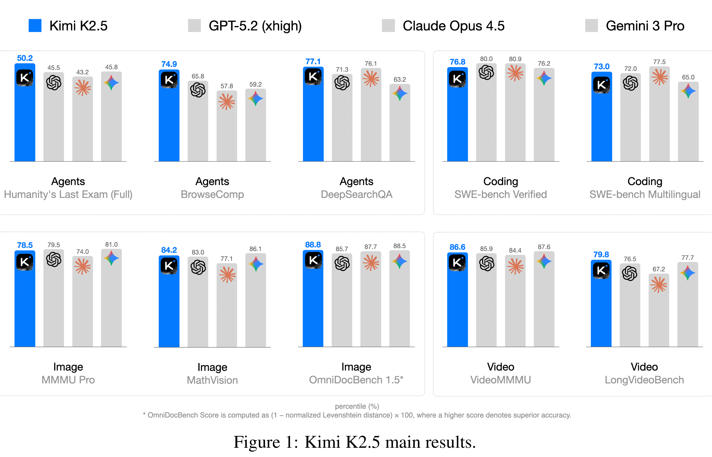

# Kimi K2.5 Technical Report

[Official source](https://github.com/MoonshotAI/Kimi-K2.5)

## ABSTRACT

We introduce Kimi K2.5, an open-source multimodal agentic model designed to advance general agentic intelligence. K2.5 emphasizes the joint optimization of text and vision so that two modalities enhance each other. This includes a series of techniques such as joint text-vision pre-training, zero-vision SFT, and joint text-vision reinforcement learning. Building on this multimodal foundation, K2.5 introduces Agent Swarm, a self-directed parallel agent orchestration framework that dynamically decomposes complex tasks into heterogeneous sub-problems and executes them concurrently. Extensive evaluations show that Kimi K2.5 achieves state-of-the-art results across various domains including coding, vision, reasoning, and agentic tasks. Agent Swarm also reduces latency by up to 4.5× over single-agent baselines. We release the post-trained Kimi K2.5 model checkpoint1 to facilitate future research and real-world applications of agentic intelligence.

Figure 1: Kimi K2.5 main results.

p. 1
