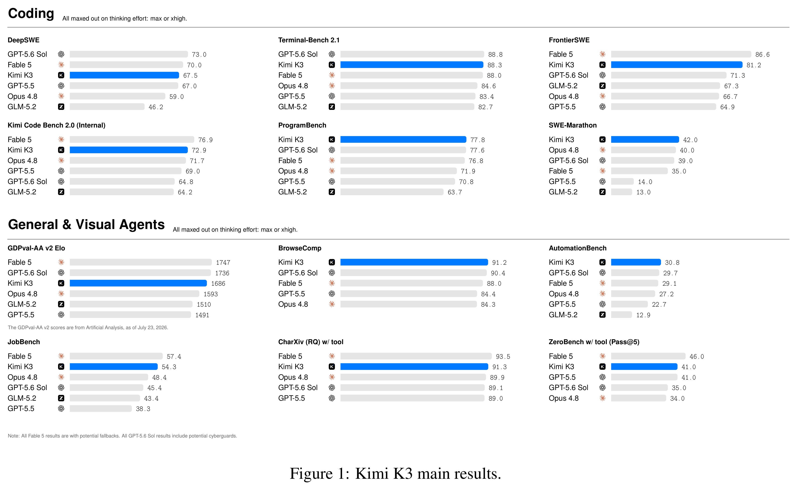
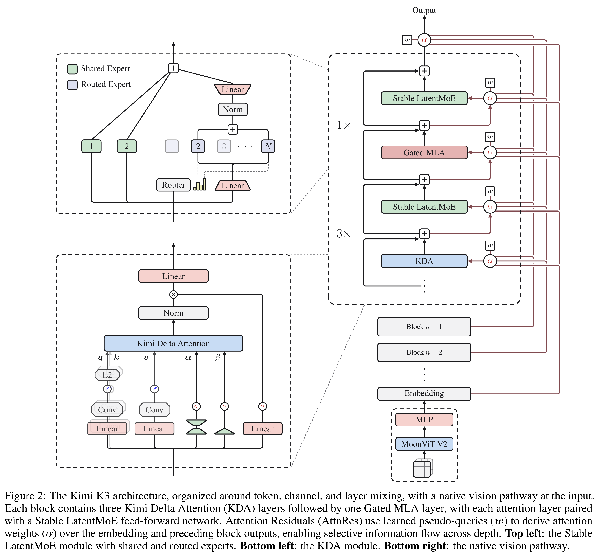

# Kimi K3 Technical Report

Models: Kimi K3

[Source summaries](../README.md) · [中文索引](../README_CN.md)

[Original PDF](../../pdfs/moonshot/technical-reports/kimi-k3-technical-report.pdf#page=1) · [Official source](https://github.com/MoonshotAI/Kimi-K3)

PDF pages: 1 · Source passage visually checked against the PDF page.

## ABSTRACT

We introduce Kimi K3, a 2.8T parameter Mixture-of-Experts model with 104 billion activated parameters, native vision capabilities, and a 1-million-token context window. Kimi K3 is built on Kimi Delta Attention [64] and Attention Residuals [58], which improve information flow across sequence length and model depth. Together with Stable LatentMoE, which effectively activates 16 of 896 routed experts per token, and refined training and data recipes, these advances yield an approximately 2.5× improvement in overall scaling efficiency over Kimi K2 [59]. Post-training highlights reinforcement learning across general, agentic, and coding domains and multiple reasoning- effort levels, enabling compositional generalization and robust long-horizon execution. At 2.8T scale, Kimi K3 is supported by infrastructure advances in multiple areas: algorithm-system co-design for KDA, perfectly balanced expert-parallel training with efficient memory management, million-token agentic RL with persistent rollout and sandbox states, and deployment innovations. Extensive evaluations show that Kimi K3 achieves frontier-level performance across long-horizon coding, agentic, knowledge, reasoning, and vision tasks. While its overall performance still trails the most powerful proprietary models, namely Claude Fable 5 and GPT-5.6 Sol, Kimi K3 consistently outperforms other open and proprietary models evaluated in our suite. We release the full Kimi K3 model weights to facilitate future research and accelerate the broader deployment and adoption of frontier intelligence.1

## Core figures

[All figures and original captions](../../figures/moonshot/kimi-k3-technical-report/README.md) · [中文](../../figures/moonshot/kimi-k3-technical-report/README_CN.md)

### Results · Figure 1

Source page: 1 · [Original graphics PDF](../../figures/moonshot/kimi-k3-technical-report/figure-01.pdf) · [High-resolution PNG](../../figures/moonshot/kimi-k3-technical-report/figure-01.png)

Figure 1: Kimi K3 main results.

### Architecture · Figure 2

Source page: 3 · [Original graphics PDF](../../figures/moonshot/kimi-k3-technical-report/figure-02.pdf) · [High-resolution PNG](../../figures/moonshot/kimi-k3-technical-report/figure-02.png)

Figure 2: The Kimi K3 architecture, organized around token, channel, and layer mixing, with a native vision pathway at the input.
Each block contains three Kimi Delta Attention (KDA) layers followed by one Gated MLA layer, with each attention layer paired
with a Stable LatentMoE feed-forward network. Attention Residuals (AttnRes) use learned pseudo-queries (w) to derive attention
weights (α) over the embedding and preceding block outputs, enabling selective information flow across depth. Top left: the Stable
LatentMoE module with shared and routed experts. Bottom left: the KDA module. Bottom right: the native vision pathway.
