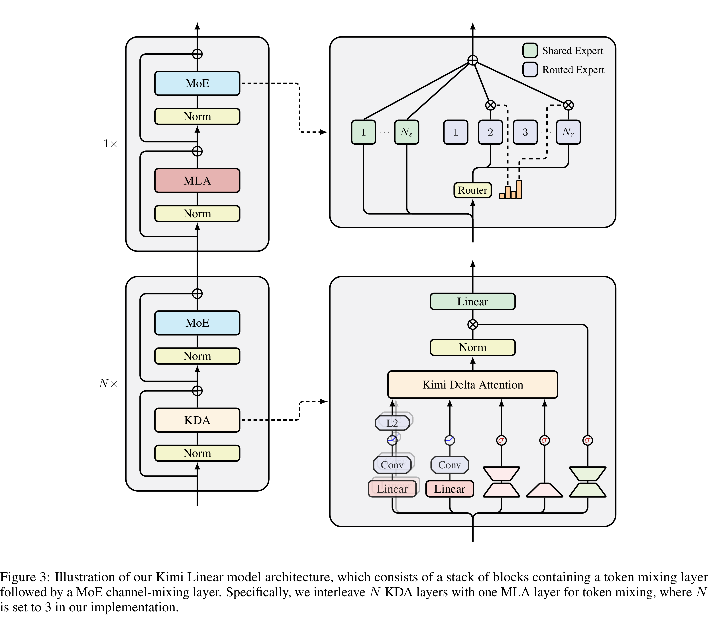

# Kimi Linear: An Expressive, Efficient Attention Architecture

[Official source](https://github.com/MoonshotAI/Kimi-Linear)

## ABSTRACT

We introduce Kimi Linear, a hybrid linear attention architecture that, for the first time, outperforms full attention under fair comparisons across various scenarios—including short-context, long-context, and reinforcement learning (RL) scaling regimes. At its core lies Kimi Delta Attention (KDA), an expressive linear attention module that extends Gated DeltaNet [111] with a finer-grained gating mechanism, enabling more effective use of limited finite-state RNN memory. Our bespoke chunkwise algorithm achieves high hardware efficiency through a specialized variant of the Diagonal-Plus-Low-Rank (DPLR) transition matrices, which substantially reduces computation compared to the general DPLR formulation while remaining more consistent with the classical delta rule. We pretrain a Kimi Linear model with 3B activated parameters and 48B total parameters, based on a layerwise hybrid of KDA and Multi-Head Latent Attention (MLA). Our experiments show that with an identical training recipe, Kimi Linear outperforms full MLA with a sizeable margin across all evaluated tasks, while reducing KV cache usage by up to 75% and achieving up to 6× decoding throughput for a 1M context. These results demonstrate that Kimi Linear can be a drop-in replacement for full attention architectures with superior performance and efficiency, including tasks with longer input and output lengths. To support further research, we open-source the KDA kernel and vLLM implementations 1, and release the pre-trained and instruction-tuned model checkpoints. 2

(a)

(b)

Figure 3: Illustration of our Kimi Linear model architecture, which consists of a stack of blocks containing a token mixing layer followed by a MoE channel-mixing layer. Specifically, we interleave N KDA layers with one MLA layer for token mixing, where N is set to 3 in our implementation.

p. 6
