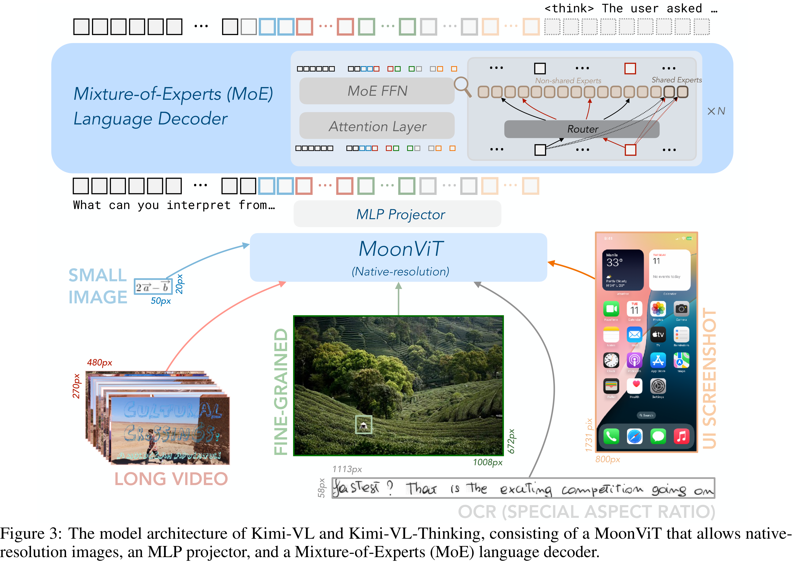

# Kimi-VL Technical Report

[Official source](https://github.com/MoonshotAI/Kimi-VL)

## ABSTRACT

We present Kimi-VL, an efficient open-source Mixture-of-Experts (MoE) vision-language model (VLM) that offers advanced multimodal reasoning, long-context understanding, and strong agent capabilities—all while activating only 2.8B parameters in its language decoder (Kimi-VL-A3B). Kimi-VL demonstrates strong performance across challenging domains: as a general-purpose VLM, Kimi-VL excels in multi-turn agent tasks (e.g., OSWorld), matching flagship models. Furthermore, it exhibits remarkable capabilities across diverse challenging vision language tasks, including college-level image and video comprehension, OCR, mathematical reasoning, multi-image understanding. In comparative evaluations, it effectively competes with cutting-edge efficient VLMs such as GPT-4o-mini, Qwen2.5-VL-7B, and Gemma-3-12B-IT, while surpassing GPT-4o in several key domains. Kimi-VL also advances in processing long contexts and perceiving clearly. With a 128K extended context window, Kimi-VL can process diverse long inputs, achieving impressive scores of 64.5 on LongVideoBench and 35.1 on MMLongBench-Doc. Its native-resolution vision encoder, MoonViT, further allows it to see and understand ultra-high-resolution visual inputs, achieving 83.2 on InfoVQA and 34.5 on ScreenSpot-Pro, while maintaining lower computational cost for common tasks. Building upon Kimi-VL, we introduce an advanced long-thinking variant: Kimi-VL-Thinking-2506. Developed through long chain-of-thought (CoT) supervised fine-tuning (SFT) and reinforcement learning (RL), the latest model exhibits strong long-horizon reasoning capabilities (64.0 on MMMU, 46.3 on MMMU-Pro, 56.9 on MathVision, 80.1 on MathVista, 65.2 on VideoMMMU) while obtaining robust general abilities (84.4 on MMBench, 83.2 on V* and 52.8 on ScreenSpot-Pro). With only around 3B activated parameters, it sets a new standard for efficient yet capable multimodal thinking models. Code and models are publicly accessible at https://github.com/MoonshotAI/Kimi-VL.

Figure 3: The model architecture of Kimi-VL and Kimi-VL-Thinking, consisting of a MoonViT that allows native-resolution images, an MLP projector, and a Mixture-of-Experts (MoE) language decoder.

p. 3
