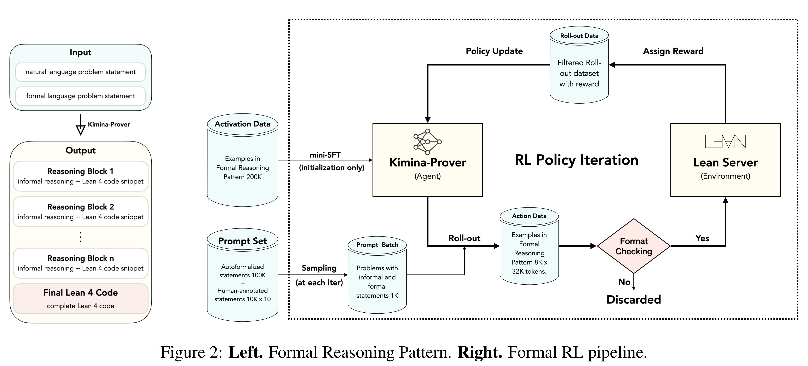

# Kimina-Prover Preview: Towards Large Formal Reasoning Models with Reinforcement Learning

[Official source](https://github.com/MoonshotAI/Kimina-Prover-Preview)

## ABSTRACT

We introduce Kimina-Prover Preview, a large language model that pioneers a novel reasoning-driven exploration paradigm for formal theorem proving, as showcased in this preview release. Trained with a large-scale reinforcement learning pipeline from Qwen2.5-72B, Kimina-Prover demonstrates strong performance in Lean 4 proof generation by employing a structured reasoning pattern we term formal reasoning pattern. This approach allows the model to emulate human problem-solving strategies in Lean, iteratively generating and refining proof steps. Kimina-Prover sets a new state-of-the-art on the miniF2F benchmark, reaching 80.7% with pass@8192. Beyond improved benchmark performance, our work yields several key insights: (1) Kimina-Prover exhibits high sample efficiency, delivering strong results even with minimal sampling (pass@1) and scaling effectively with computational budget, stemming from its unique reasoning pattern and RL training; (2) we demonstrate clear performance scaling with model size, a trend previously unobserved for neural theorem provers in formal mathematics; (3) the learned reasoning style, distinct from traditional search algorithms, shows potential to bridge the gap between formal verification and informal mathematical intuition. We open source distilled versions with 1.5B and 7B parameters of Kimina-Prover1.

Figure 2: Left. Formal Reasoning Pattern. Right. Formal RL pipeline.

p. 3
