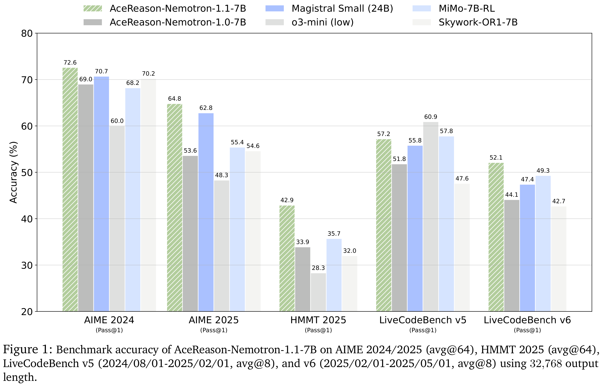

# AceReason-Nemotron 1.1: Advancing Math and Code Reasoning through SFT and RL Synergy

[Official source](https://arxiv.org/abs/2506.13284)

## Abstract

In this work, we investigate the synergy between supervised fine-tuning (SFT) and reinforcement learning (RL) in developing strong reasoning models. We begin by curating the SFT training data through two scaling strategies: increasing the number of collected prompts and the number of generated responses per prompt. Both approaches yield notable improvements in reasoning performance, with scaling the number of prompts resulting in more substantial gains. We then explore the following questions regarding the synergy between SFT and RL: (i) Does a stronger SFT model consistently lead to better final performance after large-scale RL training? (ii) How can we determine an appropriate sampling temperature during RL training to effectively balance exploration and exploitation for a given SFT initialization? Our findings suggest that (i) holds true, provided effective RL training is conducted, particularly when the sampling temperature is carefully chosen to maintain the temperature-adjusted entropy around 0.3, a setting that strikes a good balance between exploration and exploitation. Notably, the performance gap between initial SFT models narrows significantly throughout the RL process. Leveraging a strong SFT foundation and insights into the synergistic interplay between SFT and RL, our AceReason-Nemotron-1.1 7B model significantly outperforms AceReason-Nemotron-1.0 and achieves new state-of-the-art performance among Qwen2.5-7B-based reasoning models on challenging math and code benchmarks, thereby demonstrating the effectiveness of our post-training recipe. We release the model and data at: https://huggingface.co/nvidia/AceReason-Nemotron-1.1-7B.

Figure 1: Benchmark accuracy of AceReason-Nemotron-1.1-7B on AIME 2024/2025 (avg@64), HMMT 2025 (avg@64), LiveCodeBench v5 (2024/08/01-2025/02/01, avg@8), and v6 (2025/02/01-2025/05/01, avg@8) using 32,768 output length.

p. 1
