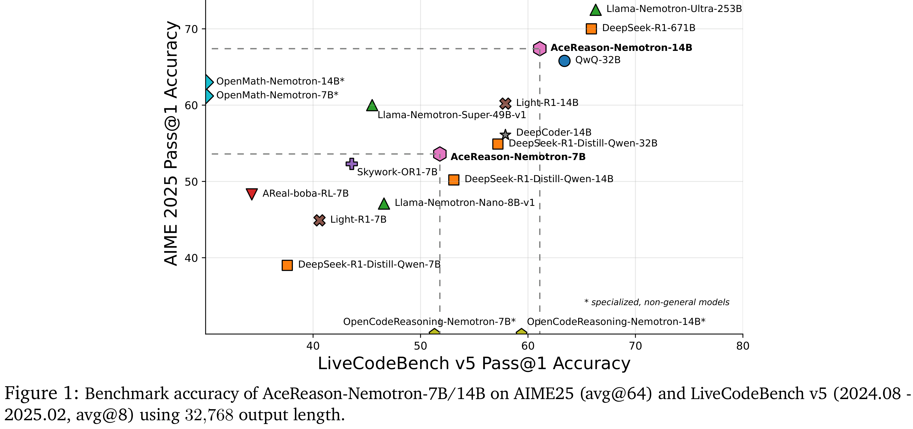

# AceReason-Nemotron: Advancing Math and Code Reasoning through Reinforcement Learning

[Official source](https://arxiv.org/abs/2505.16400)

## Abstract

Despite recent progress in large-scale reinforcement learning (RL) for reasoning, the training recipe for building high-performing reasoning models remains elusive. Key implementation details of frontier models, such as DeepSeek-R1, including data curation strategies and RL training recipe, are often omitted. Moreover, recent research indicates distillation remains more effective than RL for smaller models. In this work, we demonstrate that large-scale RL can significantly enhance the reasoning capabilities of strong, small- and mid-sized models, achieving results that surpass those of state-of-the-art distillation-based models. We systematically study the RL training process through extensive ablations and propose a simple yet effective approach: first training on math-only prompts, then on code-only prompts. Notably, we find that math-only RL not only significantly enhances the performance of strong distilled models on math benchmarks (e.g., +14.6% / +17.2% on AIME 2025 for the 7B / 14B models), but also code reasoning tasks (e.g., +6.8% / +5.8% on LiveCodeBench for the 7B / 14B models). In addition, extended code-only RL iterations further improve code benchmark performance with minimal or no degradation in math results. We develop a robust data curation pipeline to collect challenging prompts with high-quality, verifiable answers and test cases to enable verification-based RL across both domains. Finally, we identify key experimental insights, including curriculum learning with progressively increasing response lengths and the stabilizing effect of on-policy parameter updates. We find that RL not only elicits the foundational reasoning capabilities acquired during pretraining and supervised fine-tuning (e.g., distillation), but also pushes the limits of the model’s reasoning ability, enabling it to solve problems that were previously unsolvable. We release the model at: https://huggingface.co/nvidia/AceReason-Nemotron-14B.

Figure 1: Benchmark accuracy of AceReason-Nemotron-7B/14B on AIME25 (avg@64) and LiveCodeBench v5 (2024.08 - 2025.02, avg@8) using 32,768 output length.

p. 1
