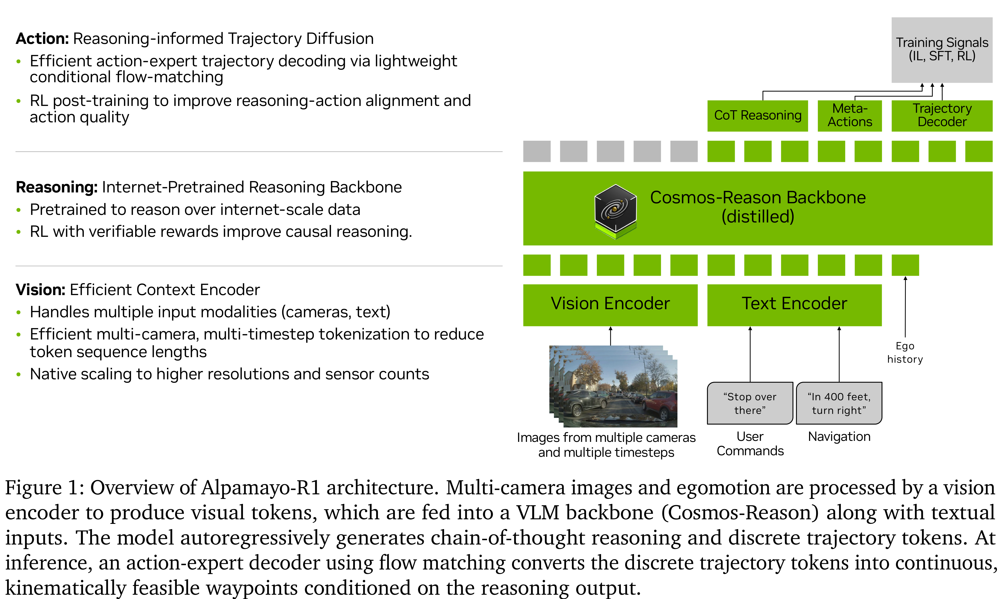

# Alpamayo-R1: Bridging Reasoning and Action Prediction for Generalizable Autonomous Driving in the Long Tail

[Official source](https://arxiv.org/abs/2511.00088)

## Abstract

End-to-end architectures trained via imitation learning have advanced autonomous driving by scaling model size and data, yet performance remains brittle in safety-critical long-tail scenarios where supervision is sparse and causal understanding is limited. We introduce Alpamayo-R1 (AR1), a vision–language–action model (VLA) that integrates Chain of Causation reasoning with trajectory planning for complex driving scenarios. Our approach features three key innovations: (1) the Chain of Causation (CoC) dataset, built through a hybrid auto-labeling and human-in-the-loop pipeline producing decision-grounded, causally linked reasoning traces aligned with driving behaviors; (2) a modular VLA architecture combining Cosmos-Reason, a vision-language model pre-trained for Physical AI, with a diffusion-based trajectory decoder that generates dynamically feasible trajectories in real time; (3) a multi-stage training strategy using supervised fine-tuning to elicit reasoning and reinforcement learning (RL) to enforce reasoning-action consistency and optimize reasoning quality. AR1 achieves up to a 12% improvement in planning accuracy on challenging cases compared to a trajectory-only baseline, with a 35% reduction in close encounter rate in closed-loop simulation. RL post-training improves reasoning quality by 45% and reasoning-action consistency by 37%. Model scaling from 0.5B to 7B parameters shows consistent improvements. On-vehicle road tests confirm real-time performance (99 ms latency) and successful urban deployment. By bridging interpretable reasoning with precise control, AR1 demonstrates a practical path towards Level 4 autonomous driving. Model weights are available at https://huggingface.co/nvidia/Alpamayo-R1-10B with inference code at https://github.com/NVlabs/alpamayo.

Figure 1: Overview of Alpamayo-R1 architecture. Multi-camera images and egomotion are processed by a vision encoder to produce visual tokens, which are fed into a VLM backbone (Cosmos-Reason) along with textual inputs. The model autoregressively generates chain-of-thought reasoning and discrete trajectory tokens. At inference, an action-expert decoder using flow matching converts the discrete trajectory tokens into continuous, kinematically feasible waypoints conditioned on the reasoning output.

p. 5
