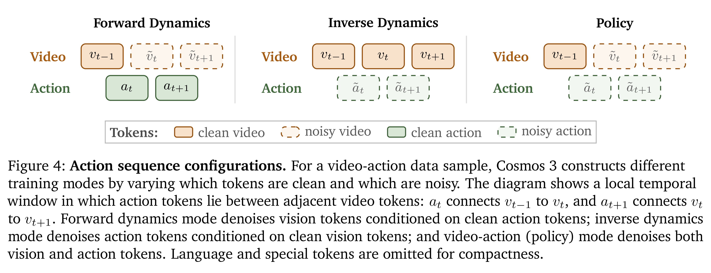
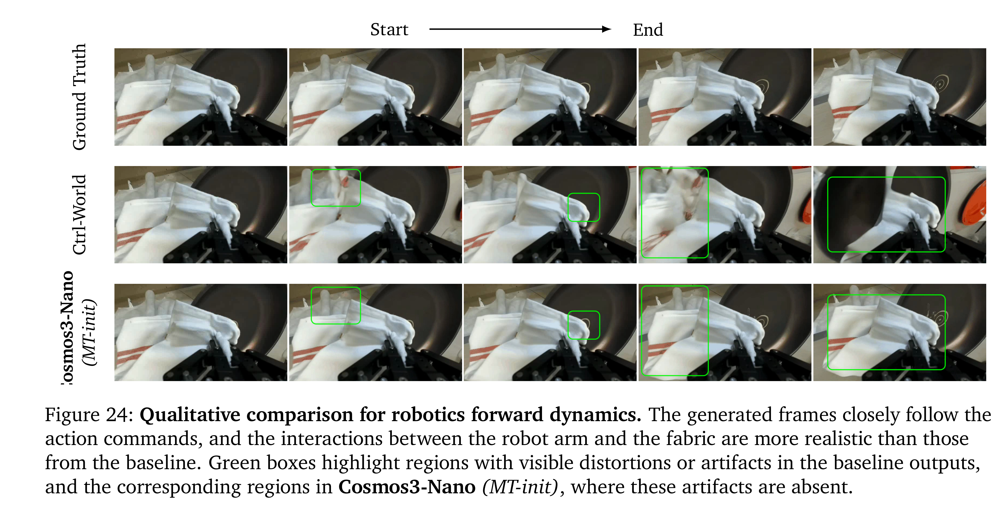

# Cosmos 3: Omnimodal World Models for Physical AI

[Official source](https://research.nvidia.com/labs/cosmos-lab/cosmos3/)

## Abstract

We introduce Cosmos 3, a family of omnimodal world models designed to jointly process and generate language, image, video, audio, and action sequences within a unified mixture-of-transformers architecture. By supporting highly flexible input-output configurations, Cosmos 3 seamlessly unifies critical modalities for Physical AI—effectively subsuming vision-language models, video generators, world simulators, and world-action models into a single framework. Our evaluation demonstrates that Cosmos 3 establishes a new state-of-the-art across a diverse suite of understanding and generation tasks, demonstrating omnimodal world models as scalable, general-purpose backbones for embodied agents. Our post-trained Cosmos 3 models were ranked as the best open-source Text-to-Image and Image-to-Video models by Artificial Analysis, and the best policy model by RoboArena at the time the technical report was written. To accelerate open research and deployment in Physical AI, we make our code, model checkpoints, curated synthetic datasets, and evaluation benchmark available under the Linux Foundation’s OpenMDW-1.1 License at github.com/nvidia/cosmos and huggingface.co/collections/nvidia/cosmos3 . The project website is available at research.nvidia.com/labs/cosmos-lab/cosmos3 .

## 2. Model Architecture

Cosmos 3 is capable of processing multimodal inputs and generating multimodal outputs. Beyond language, vision (image and video), and audio, Cosmos 3 treats action as a core modality, introducing a dedicated class of action tokens. These action tokens bridge the physical world with language-based reasoning and video-based world modeling, linking directly to physically grounded control signals for real-world interaction.

p. 7

Figure 4: Action sequence configurations. For a video-action data sample, Cosmos 3 constructs different training modes by varying which tokens are clean and which are noisy. The diagram shows a local temporal window in which action tokens lie between adjacent video tokens: 𝑎𝑡connects 𝑣𝑡−1 to 𝑣𝑡, and 𝑎𝑡+1 connects 𝑣𝑡 to 𝑣𝑡+1. Forward dynamics mode denoises vision tokens conditioned on clean action tokens; inverse dynamics mode denoises action tokens conditioned on clean vision tokens; and video-action (policy) mode denoises both vision and action tokens. Language and special tokens are omitted for compactness.

p. 10

Figure 24: Qualitative comparison for robotics forward dynamics. The generated frames closely follow the action commands, and the interactions between the robot arm and the fabric are more realistic than those from the baseline. Green boxes highlight regions with visible distortions or artifacts in the baseline outputs, and the corresponding regions in Cosmos3-Nano (MT-init), where these artifacts are absent.

p. 68
