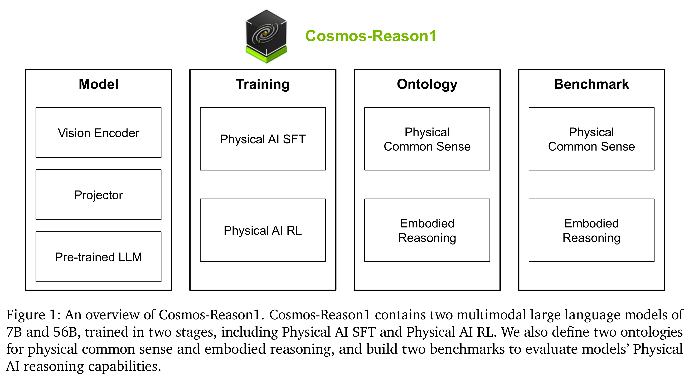

# Cosmos-Reason1: From Physical Common Sense To Embodied Reasoning

[Official source](https://arxiv.org/abs/2503.15558)

## Abstract

Physical AI systems need to perceive, understand, and perform complex actions in the physical world. In this paper, we present the Cosmos-Reason1 models that can understand the physical world and generate appropriate embodied decisions (e.g., next step action) in natural language through long chain-of-thought reasoning processes. We begin by defining key capabilities for Physical AI reasoning, with a focus on physical common sense and embodied reasoning. To represent physical common sense, we use a hierarchical ontology that captures fundamental knowledge about space, time, and physics. For embodied reasoning, we rely on a two-dimensional ontology that generalizes across different physical embodiments. Building on these capabilities, we develop two multimodal large language models, Cosmos-Reason1-7B and Cosmos-Reason1-56B. We curate data and train our models in two stages: Physical AI supervised fine-tuning (SFT) and Physical AI reinforcement learning (RL). To evaluate our models, we build comprehensive benchmarks for physical common sense and embodied reasoning according to our ontologies. Evaluation results show that Physical AI SFT and RL bring significant improvements. To facilitate the development of Physical AI, we make our code and pre-trained models available under the NVIDIA Open Model License at https://github.com/nvidia-cosmos/cosmos-reason1.

Figure 1: An overview of Cosmos-Reason1. Cosmos-Reason1 contains two multimodal large language models of 7B and 56B, trained in two stages, including Physical AI SFT and Physical AI RL. We also define two ontologies for physical common sense and embodied reasoning, and build two benchmarks to evaluate models’ Physical AI reasoning capabilities.

p. 2
