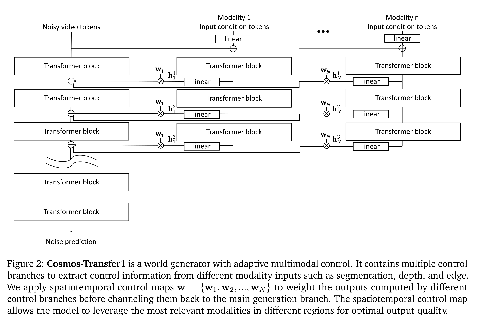
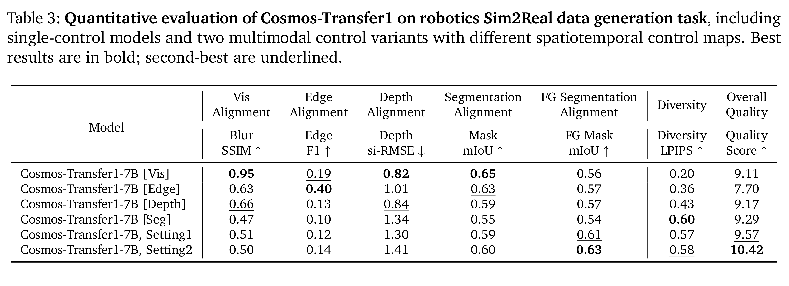

# Cosmos-Transfer1: Conditional World Generation with Adaptive Multimodal Control

[Official source](https://arxiv.org/abs/2503.14492)

## Abstract

We introduce Cosmos-Transfer1, a conditional world generation model that can generate world simula- tions based on multiple spatial control inputs of various modalities such as segmentation, depth, and edge. In the design, the spatial conditional scheme is adaptive and customizable. It allows weighting different conditional inputs differently at different spatial locations. This enables highly controllable world generation and finds use in various world-to-world transfer use cases, including Sim2Real. We conduct extensive evaluations to analyze the proposed model and demonstrate its applications for Physical AI, including robotics Sim2Real and autonomous vehicle data enrichment. We further demon- strate an inference scaling strategy to achieve real-time world generation with an NVIDIA GB200 NVL72 rack. To help accelerate research development in the field, we open-source our models and code at https://github.com/nvidia-cosmos/cosmos-transfer1.

Figure 2: Cosmos-Transfer1 is a world generator with adaptive multimodal control. It contains multiple control branches to extract control information from different modality inputs such as segmentation, depth, and edge. We apply spatiotemporal control maps w = {w1, w2, ..., w𝑁} to weight the outputs computed by different control branches before channeling them back to the main generation branch. The spatiotemporal control map allows the model to leverage the most relevant modalities in different regions for optimal output quality.

p. 3

Table 3: Quantitative evaluation of Cosmos-Transfer1 on robotics Sim2Real data generation task, including single-control models and two multimodal control variants with different spatiotemporal control maps. Best results are in bold; second-best are underlined.

p. 12
