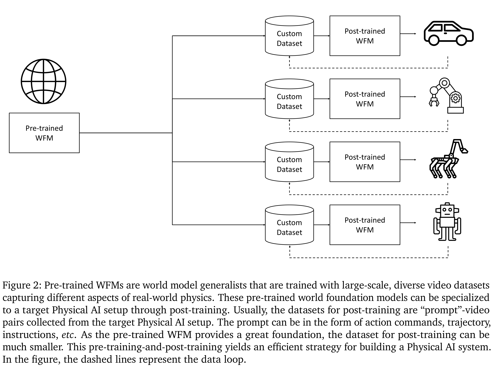

# Cosmos World Foundation Model Platform for Physical AI

[Official source](https://arxiv.org/abs/2501.03575)

## Abstract

Physical AI needs to be trained digitally first. It needs a digital twin of itself, the policy model, and a digital twin of the world, the world model. In this paper, we present the Cosmos World Foundation Model Platform to help developers build customized world models for their Physical AI setups. We position a world foundation model as a general-purpose world model that can be fine-tuned into customized world models for downstream applications. Our platform covers a video curation pipeline, pre-trained world foundation models, examples of post-training of pre-trained world foundation models, and video tokenizers. To help Physical AI builders solve the most critical problems of our society, we make Cosmos open-source and our models open-weight with permissive licenses available via NVIDIA Cosmos-Predict1.

Figure 2: Pre-trained WFMs are world model generalists that are trained with large-scale, diverse video datasets
capturing different aspects of real-world physics. These pre-trained world foundation models can be specialized
to a target Physical AI setup through post-training. Usually, the datasets for post-training are “prompt”-video
pairs collected from the target Physical AI setup. The prompt can be in the form of action commands, trajectory,
instructions, etc. As the pre-trained WFM provides a great foundation, the dataset for post-training can be
much smaller. This pre-training-and-post-training yields an efficient strategy for building a Physical AI system.
In the figure, the dashed lines represent the data loop.

p. 3
