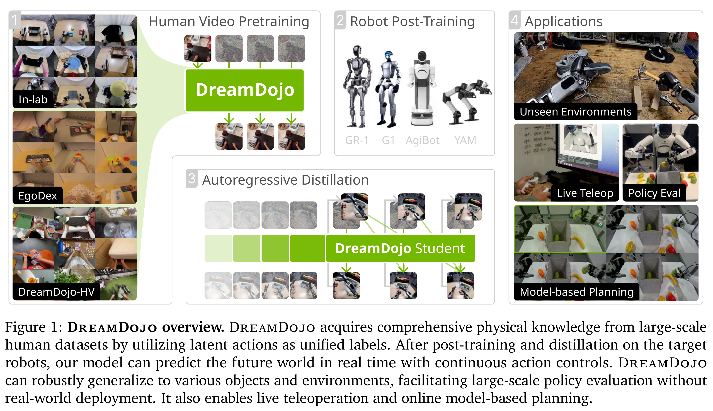
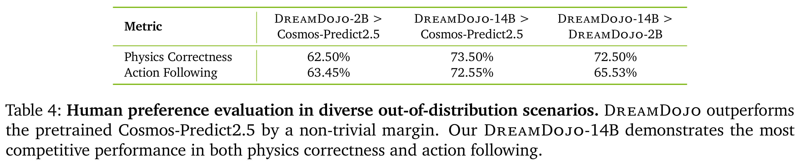

# DreamDojo: A Generalist Robot World Model from Large-Scale Human Videos

[Official source](https://arxiv.org/abs/2602.06949)

## Abstract

Being able to simulate the outcomes of actions in varied environments will revolutionize the development of generalist agents at scale. However, modeling these world dynamics, especially for dexterous robotics tasks, poses significant challenges due to limited data coverage and scarce action labels. As an endeavor towards this end, we introduce DreamDojo, a foundation world model that learns diverse interactions and dexterous controls from 44k hours of egocentric human videos. Our data mixture represents the largest video dataset to date for world model pretraining, spanning a wide range of daily scenarios with diverse objects and skills. To address the scarcity of action labels, we introduce continuous latent actions as unified proxy actions, enhancing interaction knowledge transfer from unlabeled videos. After post-training on small-scale target robot data, DreamDojo demonstrates a strong understanding of physics and precise action controllability. We also devise a distillation pipeline that accelerates DreamDojo to a real-time speed of 10.81 FPS and further improves context consistency. Our work enables several important applications based on generative world models, including live teleoperation, policy evaluation, and model-based planning. Systematic evaluation on multiple challenging out-of-distribution (OOD) benchmarks verifies the significance of our method for simulating open-world, contact-rich tasks, paving the way for general-purpose robot world models.

Figure 1: DreamDojo overview. DreamDojo acquires comprehensive physical knowledge from large-scale human datasets by utilizing latent actions as unified labels. After post-training and distillation on the target robots, our model can predict the future world in real time with continuous action controls. DreamDojo can robustly generalize to various objects and environments, facilitating large-scale policy evaluation without real-world deployment. It also enables live teleoperation and online model-based planning.

p. 3

Table 4: Human preference evaluation in diverse out-of-distribution scenarios. DreamDojo outperforms the pretrained Cosmos-Predict2.5 by a non-trivial margin. Our DreamDojo-14B demonstrates the most competitive performance in both physics correctness and action following.

p. 12
