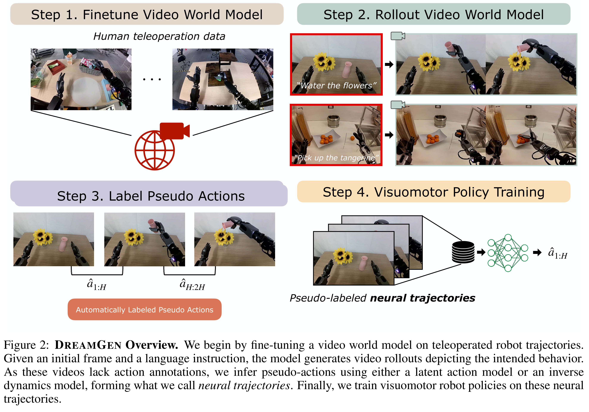
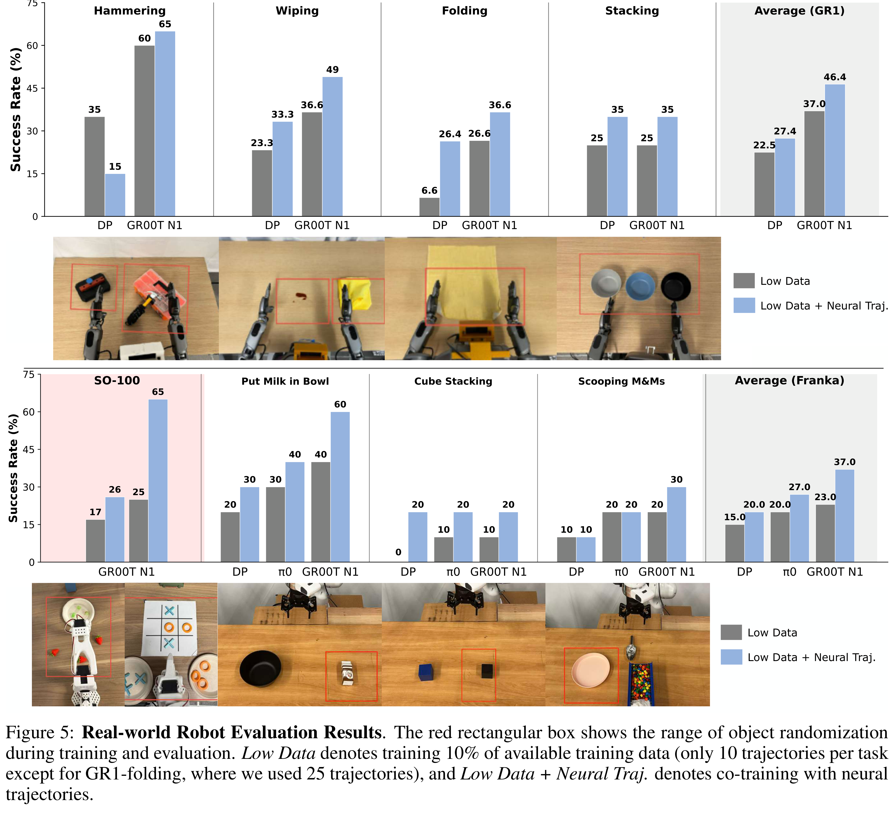

# DreamGen: Unlocking Generalization in Robot Learning through Video World Models

[Official source](https://arxiv.org/abs/2505.12705)

## Abstract:

We introduce DREAMGEN, a simple yet highly effective 4-stage pipeline for training robot policies that generalize across behaviors and environments through neural trajectories—synthetic robot data generated from video world models. DREAMGEN leverages state-of-the-art image-to-video gener- ative models, adapting them to the target robot embodiment to produce photorealistic synthetic videos of familiar or novel tasks in diverse environments. Since these models generate only videos, we re- cover pseudo-action sequences using either a latent action model or an inverse-dynamics model (IDM). Despite its simplicity, DREAMGEN unlocks strong behavior and environment generalization: a hu- manoid robot can perform 22 new behaviors in both seen and unseen environments, while requiring teleoperation data from only a single pick-and-place task in one environment. To evaluate the pipeline systematically, we introduce DreamGen Bench, a video generation benchmark that shows a strong correlation between benchmark performance and downstream policy success. Our work establishes a promising new axis for scaling robot learning well beyond manual data collection.

Figure 2: DREAMGEN Overview. We begin by fine-tuning a video world model on teleoperated robot trajectories.
Given an initial frame and a language instruction, the model generates video rollouts depicting the intended behavior.
As these videos lack action annotations, we infer pseudo-actions using either a latent action model or an inverse
dynamics model, forming what we call neural trajectories. Finally, we train visuomotor robot policies on these neural
trajectories.

p. 2

Figure 5: Real-world Robot Evaluation Results. The red rectangular box shows the range of object randomization
during training and evaluation. Low Data denotes training 10% of available training data (only 10 trajectories per task
except for GR1-folding, where we used 25 trajectories), and Low Data + Neural Traj. denotes co-training with neural
trajectories.

p. 6
