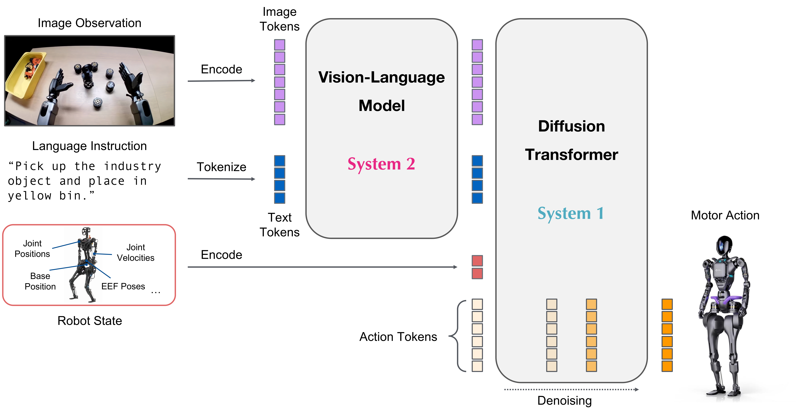

# GR00T N1.7

[Official source](https://github.com/NVIDIA/Isaac-GR00T)

NVIDIA Isaac GR00T N1.7 is an open vision-language-action (VLA) model for generalized humanoid robot skills. This cross-embodiment model takes multimodal input, including language and images, to perform manipulation tasks in diverse environments.

GR00T N1.7 is trained on a diverse mixture of robot data including bimanual, semi-humanoid and an expansive humanoid dataset. It is adaptable through post-training for specific embodiments, tasks and environments.

The neural network architecture of GR00T N1.7 is a combination of vision-language foundation model and diffusion transformer head that denoises continuous actions. Here is a schematic diagram of the architecture:

