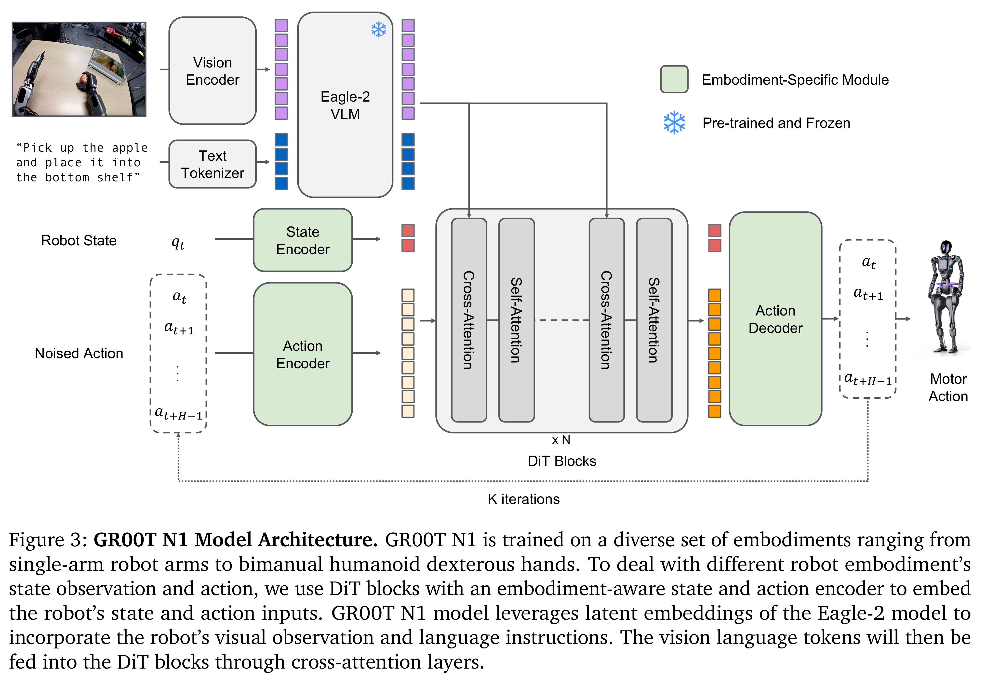

# GR00T N1: An Open Foundation Model for Generalist Humanoid Robots

[Official source](https://arxiv.org/abs/2503.14734)

## Abstract

General-purpose robots need a versatile body and an intelligent mind. Recent advancements in humanoid robots have shown great promise as a hardware platform for building generalist autonomy in the human world. A robot foundation model, trained on massive and diverse data sources, is essential for enabling the robots to reason about novel situations, robustly handle real-world variability, and rapidly learn new tasks. To this end, we introduce GR00T N1, an open foundation model for humanoid robots. GR00T N1 is a Vision-Language-Action (VLA) model with a dual-system architecture. The vision-language module (System 2) interprets the environment through vision and language instructions. The subsequent diffusion transformer module (System 1) generates fluid motor actions in real time. Both modules are tightly coupled and jointly trained end-to-end. We train GR00T N1 with a heterogeneous mixture of real-robot trajectories, human videos, and synthetically generated datasets. We show that our generalist robot model GR00T N1 outperforms the state-of-the-art imitation learning baselines on standard simulation benchmarks across multiple robot embodiments. Furthermore, we deploy our model on the Fourier GR-1 humanoid robot for language-conditioned bimanual manipulation tasks, achieving strong performance with high data efficiency.

Figure 3: GR00T N1 Model Architecture. GR00T N1 is trained on a diverse set of embodiments ranging from single-arm robot arms to bimanual humanoid dexterous hands. To deal with different robot embodiment’s state observation and action, we use DiT blocks with an embodiment-aware state and action encoder to embed the robot’s state and action inputs. GR00T N1 model leverages latent embeddings of the Eagle-2 model to incorporate the robot’s visual observation and language instructions. The vision language tokens will then be fed into the DiT blocks through cross-attention layers.

p. 4
