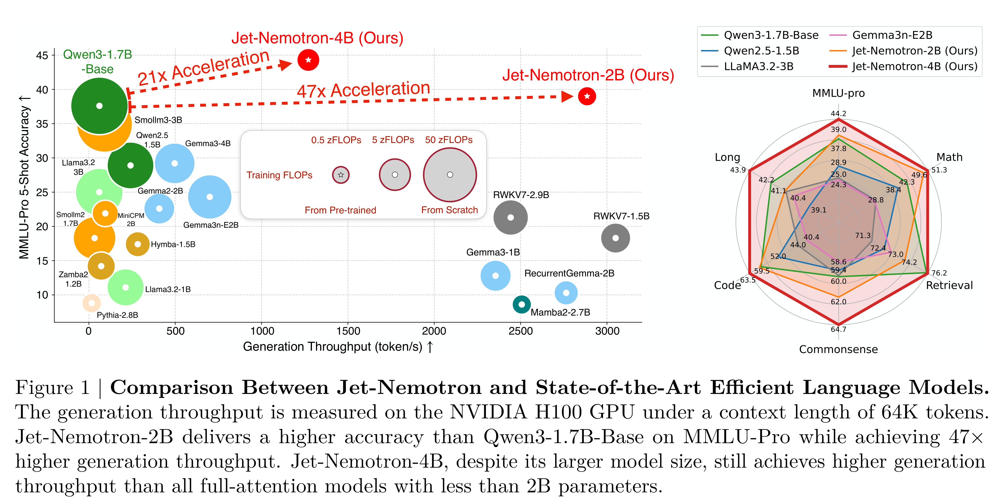

# Jet-Nemotron: Efficient Language Model with Post Neural Architecture Search

[Official source](https://arxiv.org/abs/2508.15884)

## Abstract:

We present Jet-Nemotron, a new family of hybrid-architecture language models, which matches or exceeds the accuracy of leading full-attention models while significantly improving generation throughput. Jet-Nemotron is developed using Post Neural Architecture Search (PostNAS), a novel neural architecture exploration pipeline that enables efficient model design. Unlike prior approaches, PostNAS begins with a pre-trained full-attention model and freezes its MLP weights, allowing efficient exploration of attention block designs. The pipeline includes four key components: (1) learning optimal full-attention layer placement and elimination, (2) linear attention block selection, (3) designing new attention blocks, and (4) performing hardware-aware hyperparameter search. Our Jet-Nemotron-2B model achieves comparable or superior accuracy to Qwen3, Qwen2.5, Gemma3, and Llama3.2 across a comprehensive suite of benchmarks while delivering up to 53.6× generation throughput speedup and 6.1× prefilling speedup. It also achieves higher accuracy on MMLU and MMLU-Pro than recent advanced MoE full-attention models, such as DeepSeek-V3-Small and Moonlight, despite their larger scale with 15B total and 2.2B activated parameters.

Figure 1 | Comparison Between Jet-Nemotron and State-of-the-Art Efficient Language Models. The generation throughput is measured on the NVIDIA H100 GPU under a context length of 64K tokens. Jet-Nemotron-2B delivers a higher accuracy than Qwen3-1.7B-Base on MMLU-Pro while achieving 47× higher generation throughput. Jet-Nemotron-4B, despite its larger model size, still achieves higher generation throughput than all full-attention models with less than 2B parameters.

p. 1
