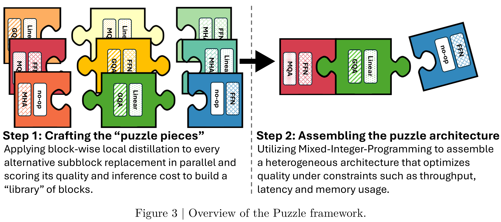

# Llama-Nemotron: Efficient Reasoning Models

[Official source](https://arxiv.org/abs/2505.00949)

## Abstract

We introduce the Llama-Nemotron series of models, an open family of heterogeneous reasoning models that deliver exceptional reasoning capabilities, inference efficiency, and an open license for enterprise use. The family comes in three sizes—Nano (8B), Super (49B), and Ultra (253B)— and performs competitively with state of the art reasoning models such as DeepSeek-R1 while offering superior inference throughput and memory efficiency. In this report, we discuss the training procedure for these models, which entails using neural architecture search from Llama 3 models for accelerated inference, knowledge distillation, and continued pretraining, followed by a reasoning-focused post-training stage consisting of two main parts: supervised fine-tuning and large scale reinforcement learning. Llama-Nemotron models are the first open-source models to support a dynamic reasoning toggle, allowing users to switch between standard chat and reasoning modes during inference. To further support open research and facilitate model development:

• We release the Llama-Nemotron reasoning models—LN-Nano, LN-Super, and LN-Ultra—under

the commercially permissive NVIDIA Open Model License Agreement.

– Llama-3.1-Nemotron-Nano-8B-v1 – Llama-3.3-Nemotron-Super-49B-v1 – Llama-3.1-Nemotron-Ultra-253B-v1 – Llama-3.1-Nemotron-Ultra-253B-CPT-v1

• We release the complete post-training dataset.

– Llama-Nemotron-Post-Training-Dataset

• We also release our training codebases: NeMo, NeMo-Aligner, Megatron-LM.

Figure 3 | Overview of the Puzzle framework.

p. 4
