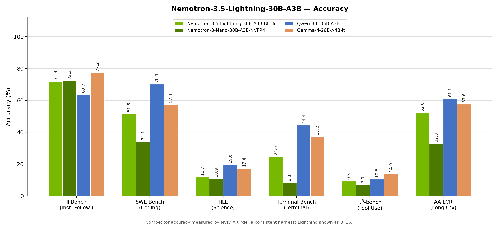
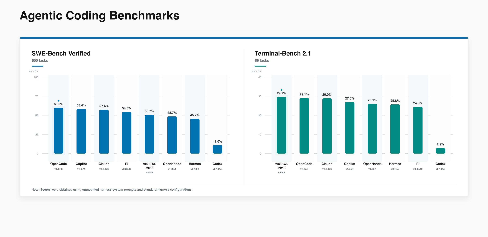

# Nemotron 3.5 Lightning

[Official source](https://huggingface.co/nvidia/NVIDIA-Nemotron-3.5-Lightning-30B-A3B-BF16)

## Description

NVIDIA-Nemotron-3.5-Lightning-30B-A3B-BF16 is a large language model (LLM) trained by NVIDIA. This is the full-precision (BF16) release of Nemotron 3.5 Lightning — the reference weights of the model, intended primarily as the starting point for customization: post-training (SFT, RL, distillation), domain adaptation, and producing your own quantized or GGUF variants. For latency- and throughput-optimized inference, use the NVFP4 release instead.

The model employs a hybrid Mixture-of-Experts architecture, utilizing interleaved Mamba-2 and MoE layers, along with select Attention layers. The Lightning 3.5 model is released alongside a number of speculative decoding methods for faster text generation. The model has 3B active parameters and 30B parameters in total.

