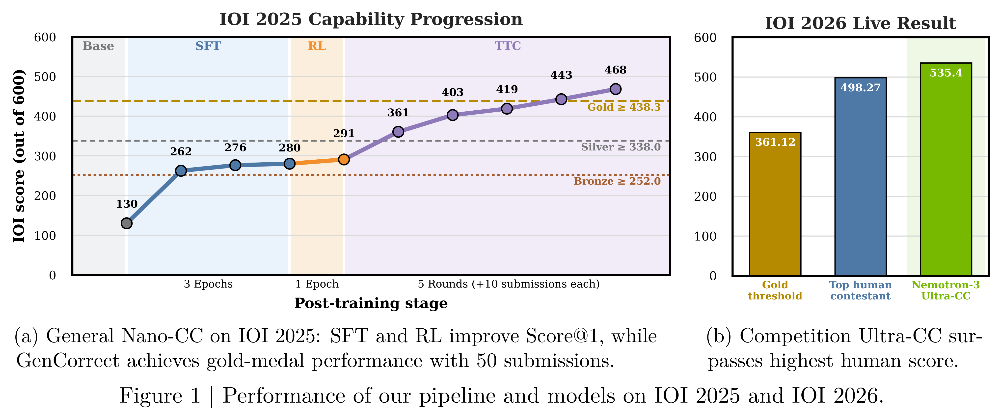
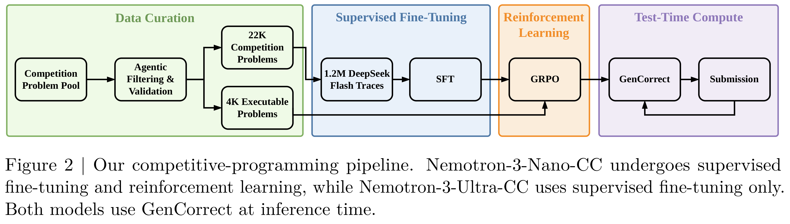

# Post-Training Language Models for Gold-Medal Performance in Coding Competitions

[Official source](https://arxiv.org/abs/2609.02849)

## Abstract.

Competitive programming has become a key test of large language model reasoning, with international competitions such as IOI and ICPC representing its most challenging settings. We present an end-to-end specialization pipeline combining large-scale problem curation, synthetic reasoning traces, supervised fine-tuning (SFT), and reinforcement learning (RL). Using 22,000 curated problems, we train Nemotron-3-Nano-CC (30B-A3B) with SFT and RL and Nemotron-3-Ultra-CC (550B-A55B) with SFT alone. We further introduce GenCorrect, a feedback-driven test-time compute strategy that iteratively generates, evaluates, and refines diverse solutions. On IOI 2025, Nano-CC improves from 130 points to 291 after post-training and to 468 with GenCorrect, exceeding the gold threshold of 438.3 while Ultra-CC reaches 502. Guided by these results, we develop a competition-specific Ultra-CC system and evaluate it prospectively during IOI 2026. Under the same time, internet-access, and submission constraints as human contestants, it scores 535.4 out of 600, exceeding both the gold threshold of 361.12 and the top human score of 498.27. To our knowledge, this is the first AI system to outscore the highest-scoring human contestant on an IOI problem set.

Figure 1 | Performance of our pipeline and models on IOI 2025 and IOI 2026.

p. 2

Figure 2 | Our competitive-programming pipeline. Nemotron-3-Nano-CC undergoes supervised fine-tuning and reinforcement learning, while Nemotron-3-Ultra-CC uses supervised fine-tuning only. Both models use GenCorrect at inference time.

p. 3
