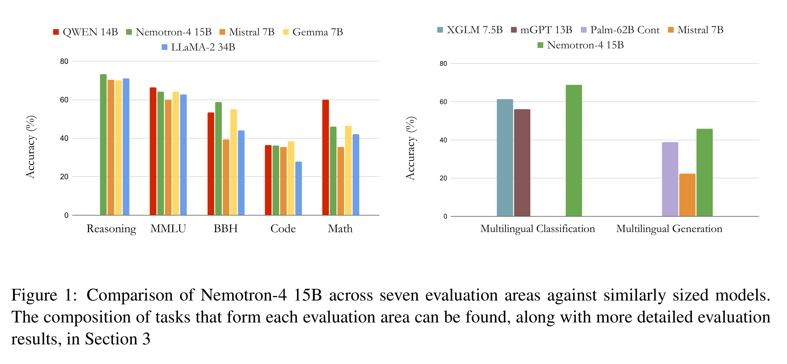

# Nemotron-4 15B Technical Report

[Official source](https://arxiv.org/abs/2402.16819)

## Abstract

We introduce Nemotron-4 15B, a 15-billion-parameter large multilingual language model trained on 8 trillion text tokens. Nemotron-4 15B demonstrates strong performance when assessed on English, multilingual, and coding tasks: it outperforms all existing similarly-sized open models on 4 out of 7 downstream evaluation areas and achieves competitive performance to the leading open models in the remaining ones. Specifically, Nemotron-4 15B exhibits the best multilingual capabilities of all similarly-sized models, even outperforming models over four times larger and those explicitly specialized for multilingual tasks.

Figure 1: Comparison of Nemotron-4 15B across seven evaluation areas against similarly sized models. The composition of tasks that form each evaluation area can be found, along with more detailed evaluation results, in Section 3

p. 2
