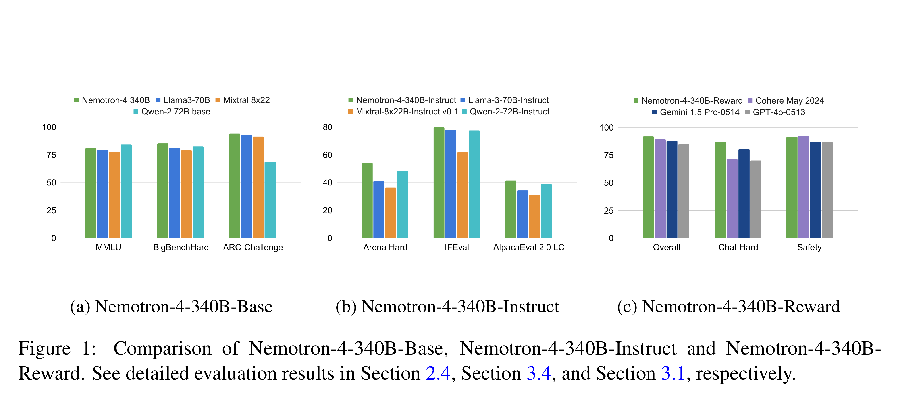

# Nemotron-4 340B Technical Report

[Official source](https://arxiv.org/abs/2406.11704)

## Abstract

We release the Nemotron-4 340B model family, including Nemotron-4-340B-Base, Nemotron-4- 340B-Instruct, and Nemotron-4-340B-Reward. Our models are open access under the NVIDIA Open Model License Agreement, a permissive model license that allows distribution, modification, and use of the models and its outputs. These models perform competitively to open access models on a wide range of evaluation benchmarks, and were sized to fit on a single DGX H100 with 8 GPUs when deployed in FP8 precision. We believe that the community can benefit from these models in various research studies and commercial applications, especially for generating synthetic data to train smaller language models. Notably, over 98% of data used in our model alignment process is synthetically generated, showcasing the effectiveness of these models in generating synthetic data. To further support open research and facilitate model development, we are also open-sourcing the synthetic data generation pipeline used in our model alignment process.

Models: Nemotron-4-340B-Base, Nemotron-4-340B-Instruct, Nemotron-4-340B-Reward. Code: Pretraining, Alignment and Reward Model Training. Webpage: Nemotron-4 340B Announcement.

Figure 1: Comparison of Nemotron-4-340B-Base, Nemotron-4-340B-Instruct and Nemotron-4-340B-Reward. See detailed evaluation results in Section 2.4, Section 3.4, and Section 3.1, respectively.

p. 2
