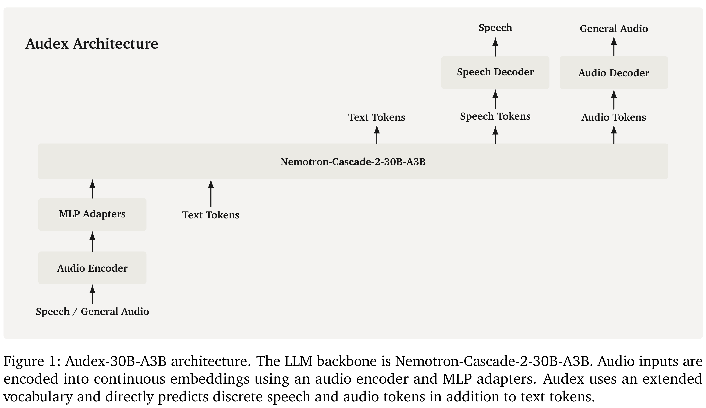

# Unified Audio Intelligence Without Regressing on Text Intelligence

[Official source](https://arxiv.org/abs/2607.05196)

## Abstract

Audio intelligence involves understanding, reasoning about, and generating both audio and speech. In this work, we introduce Nemotron-Labs-Audex-30B-A3B (Audex), a unified audio-text LLM built on Nemotron-Cascade-2- 30B-A3B, a strong text-only MoE LLM. Audex adopts a simple unified design with a single Transformer decoder: audio inputs are encoded and projected into the text embedding space, while text tokens and quantized audio output tokens are treated uniformly during generation. This architecture enables strong audio-text fusion, seamless multimodal generation, and compatibility with standard LLM training and inference infrastructure. For training, we meticulously curate audio-text datasets comprising 157.4B audio tokens and 320.5B text tokens. We apply multi-stage supervised training on these datasets, followed by text-only Cascade RL and multi-domain on-policy distillation. Audex delivers state-of-the-art audio understanding, speech recognition and translation, text-to-speech, audio generation, and speech-to-speech generation, while preserving very compelling reasoning, alignment, knowledge, long-context, and agentic capabilities of its text-only LLM backbone with marginal or no regression. We release the model checkpoints to facilitate open research.

Nemotron-Labs-Audex-30B-A3B: the audio-text to audio-text model. Nemotron-Labs-Audex-2B: the smaller 2B model uses the same training recipe as the 30B-A3B model.

Figure 1: Audex-30B-A3B architecture. The LLM backbone is Nemotron-Cascade-2-30B-A3B. Audio inputs are encoded into continuous embeddings using an audio encoder and MLP adapters. Audex uses an extended vocabulary and directly predicts discrete speech and audio tokens in addition to text tokens.

p. 4
