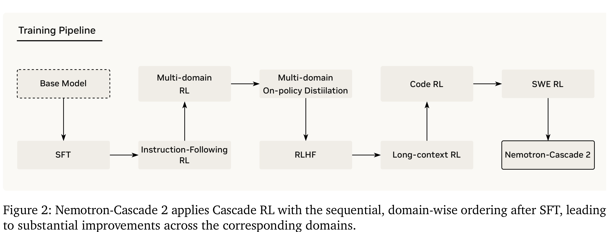

# Nemotron-Cascade 2: Post-Training LLMs with Cascade RL and Multi-Domain On-Policy Distillation

[Official source](https://arxiv.org/abs/2603.19220)

## Abstract

We introduce Nemotron-Cascade 2, an open 30B MoE model with 3B activated parameters that delivers best-in-class reasoning and strong agentic capabilities. Despite its compact size, its mathematical and coding reasoning performance approaches that of frontier open models. It is the second open-weight LLM, after DeepSeek-V3.2-Speciale-671B-A37B, to achieve Gold Medal-level performance in the 2025 International Mathematical Olympiad (IMO), the International Olympiad in Informatics (IOI), and the ICPC World Finals, demonstrating remarkably high intelligence density with 20× fewer parameters. In contrast to Nemotron-Cascade 1, the key technical advancements are as follows. After SFT on a meticulously curated dataset, we substantially expand Cascade RL to cover a much broader spectrum of reasoning and agentic domains. Furthermore, we introduce multi-domain on-policy distillation from the strongest intermediate teacher models for each domain throughout the Cascade RL process, allowing us to efficiently recover benchmark regressions and sustain strong performance gains along the way. We release the collection of model checkpoint and training data.

Nemotron-Cascade-2-30B-A3B: the post-trained model based on Nemotron-3-Nano-30B-A3B-Base. Nemotron-Cascade-2-SFT-Data: collection of SFT datasets for Nemotron-Cascade-2. Nemotron-Cascade-2-RL-Data: collection of RL datasets for Nemotron-Cascade-2.

Figure 2: Nemotron-Cascade 2 applies Cascade RL with the sequential, domain-wise ordering after SFT, leading to substantial improvements across the corresponding domains.

p. 10
