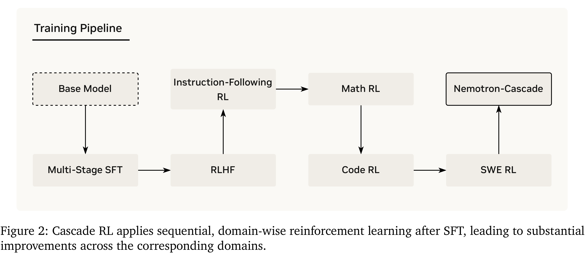

# Nemotron-Cascade: Scaling Cascaded Reinforcement Learning for General-Purpose Reasoning Models

[Official source](https://arxiv.org/abs/2512.13607)

## Abstract

Building general-purpose reasoning models with reinforcement learning (RL) entails substantial cross-domain heterogeneity, including large variation in inference-time response lengths and verification latency. Such variability complicates the RL infrastructure, slows training, and makes training curriculum (e.g., response length extension) and hyperparameter selection challenging. In this work, we propose cascaded domain-wise reinforcement learning (Cascade RL) to develop Nemotron-Cascade, capable of operating in both instruct and deep thinking modes, without any performance gap relative to a thinking-only counterpart. Departing from conventional approaches that blend heterogeneous prompts from different domains, Cascade RL orchestrates sequential, domain-wise RL, reducing engineering complexity and delivering state-of-the-art performance across a wide range of benchmarks. Notably, RLHF for alignment, when used as a pre-step, boosts the model’s reasoning ability far beyond mere preference optimization, and subsequent domain-wise RLVR stages rarely degrade the benchmark performance attained in earlier domains and may even improve it (see an illustration in Figure 1). Our 14B model, after RL, outperforms its SFT teacher, DeepSeek-R1-0528, on LiveCodeBench v5/v6/Pro and achieves silver-medal performance in the 2025 International Olympiad in Informatics (IOI). We transparently share our training and data recipes.

Figure 2: Cascade RL applies sequential, domain-wise reinforcement learning after SFT, leading to substantial improvements across the corresponding domains.

p. 5
