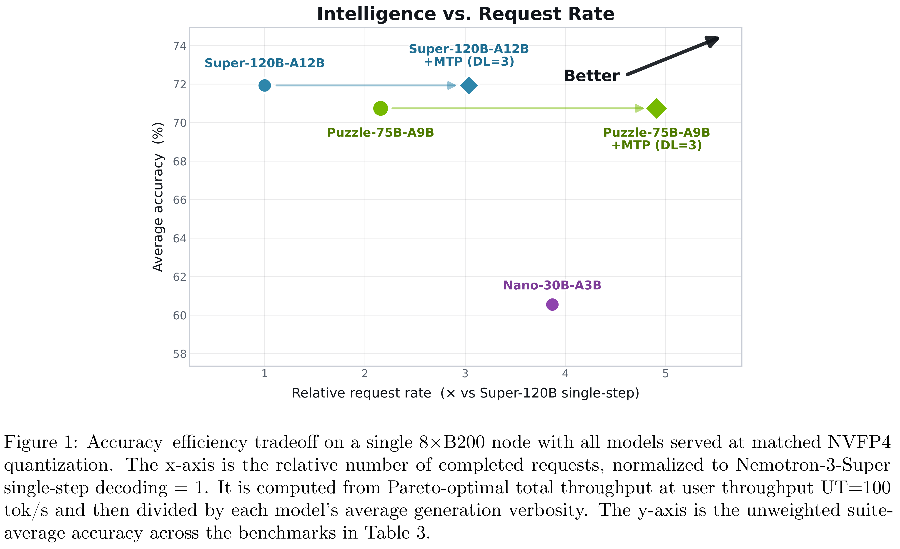

# Nemotron-Labs-3-Puzzle-75B-A9B: Compressing Hybrid MoE LLMs

[Official source](https://arxiv.org/abs/2607.04371)

## Abstract

We present Nemotron-Labs-3-Puzzle-75B-A9B, a compressed variant of Nemotron-3-Super optimized for interactive deployment. We designed the model to maximize server throughput under high user throughput constraints.

In interactive serving workloads on a single 8×B200 node, Puzzle-75B-A9B achieves approximately 2×

higher server throughput than Nemotron-3-Super at matched user throughput constraints.

In ultra-long-context deployment on a single H100 GPU, the compressed model increases 1M-token

concurrency from 1 request to 8 requests.

Puzzle-75B-A9B is constructed using a multi-stage pipeline that combines the Iterative Puzzle compression framework with knowledge distillation, reinforcement learning, quantization, and Multi-Token Prediction head. The compression process jointly optimizes heterogeneous MoE pruning, active parameter budget, and Mamba pruning to improve inference efficiency while preserving model quality.

We evaluate Puzzle-75B-A9B on a broad suite of reasoning, coding, multilingual, long-context, and agentic benchmarks. Despite substantial compression, the model retains strong downstream accuracy relative to the parent model across a wide range of tasks. These results demonstrate that large hybrid MoE models can be substantially optimized for deployment efficiency while maintaining strong downstream capability. Our model is publicly available on Hugging Face 1.

Figure 1: Accuracy–efficiency tradeoff on a single 8×B200 node with all models served at matched NVFP4 quantization. The x-axis is the relative number of completed requests, normalized to Nemotron-3-Super single-step decoding = 1. It is computed from Pareto-optimal total throughput at user throughput UT=100 tok/s and then divided by each model’s average generation verbosity. The y-axis is the unweighted suite-average accuracy across the benchmarks in Table 3.

p. 2
