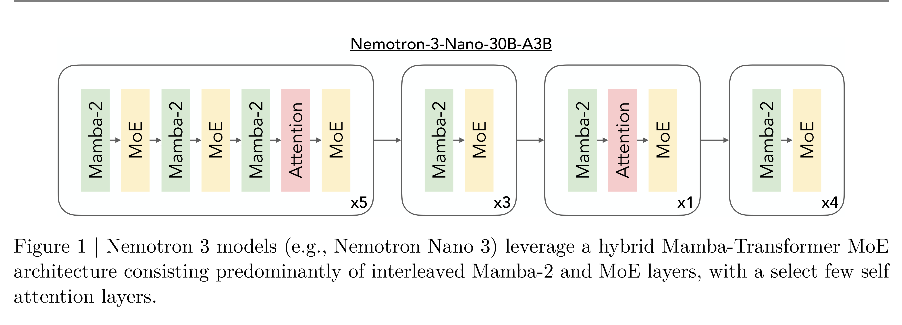

# NVIDIA Nemotron 3: Efficient and Open Intelligence

[Official source](https://research.nvidia.com/labs/nemotron/Nemotron-3/)

## Abstract

We introduce the Nemotron 3 family of models—Nano, Super, and Ultra. These models deliver strong agentic, reasoning, and conversational capabilities. The Nemotron 3 family uses a Mixture-of-Experts hybrid Mamba–Transformer architecture to provide best-in-class throughput and context lengths of up to 1M tokens. Super and Ultra models are trained with NVFP4 and incorporate LatentMoE, a novel approach that improves model quality. The two larger models also include MTP layers for faster text generation. All Nemotron 3 models are post-trained using multi-environment reinforcement learning enabling reasoning, multi-step tool use, and support granular reasoning budget control. Nano, the smallest model, outperforms comparable models in accuracy while remaining extremely cost-efficient for inference. Super is optimized for collaborative agents and high-volume workloads such as IT ticket automation. Ultra, the largest model, provides state-of-the-art accuracy and reasoning performance. Nano is released together with its technical report and this white paper, while Super and Ultra will follow in the coming months. We will openly release the model weights, pre- and post-training software, recipes, and all data for which we hold redistribution rights.

Figure 1 | Nemotron 3 models (e.g., Nemotron Nano 3) leverage a hybrid Mamba-Transformer MoE architecture consisting predominantly of interleaved Mamba-2 and MoE layers, with a select few self attention layers.

p. 2
