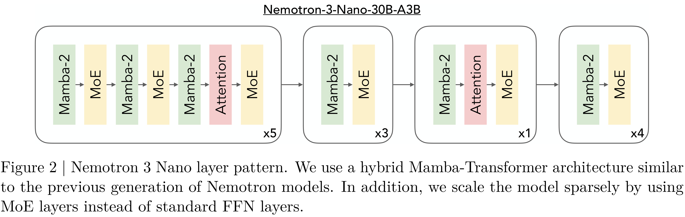

# NVIDIA Nemotron 3 Nano Technical Report

[Official source](https://research.nvidia.com/labs/nemotron/Nemotron-3/)

## Abstract.

We present Nemotron 3 Nano 30B-A3B, a Mixture-of-Experts hybrid Mamba-Transformer language model. Nemotron 3 Nano was pretrained on 25 trillion text tokens, including more than 3 trillion new unique tokens over Nemotron 2, followed by supervised fine tuning and large-scale RL on diverse environments. Nemotron 3 Nano achieves better accuracy than our previous generation Nemotron 2 Nano while activating less than half of the parameters per forward pass. It achieves up to 3.3× higher inference throughput than similarly-sized open models like GPT-OSS- 20B and Qwen3-30B-A3B-Thinking-2507, while also being more accurate on popular benchmarks. Nemotron 3 Nano demonstrates enhanced agentic, reasoning, and chat abilities and supports context lengths up to 1M tokens. We release both our pretrained Nemotron 3 Nano 30B-A3B Base and post-trained Nemotron 3 Nano 30B-A3B checkpoints on Hugging Face.

Figure 2 | Nemotron 3 Nano layer pattern. We use a hybrid Mamba-Transformer architecture similar to the previous generation of Nemotron models. In addition, we scale the model sparsely by using MoE layers instead of standard FFN layers.

p. 3
