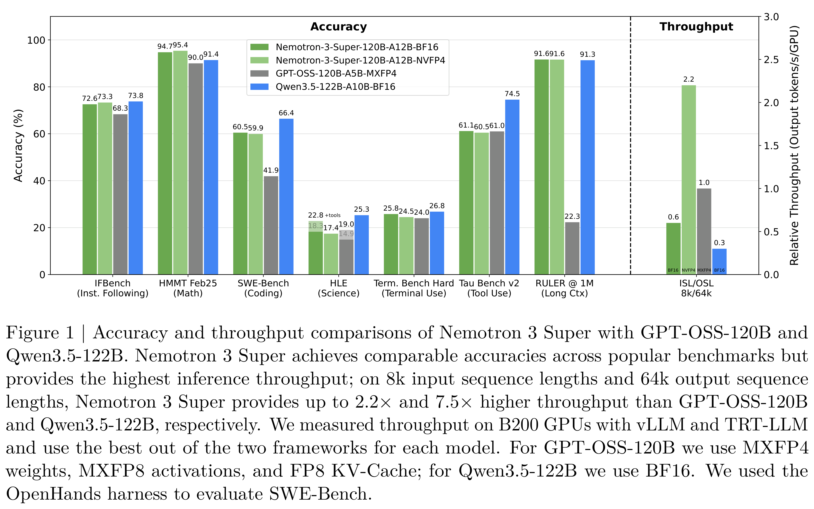
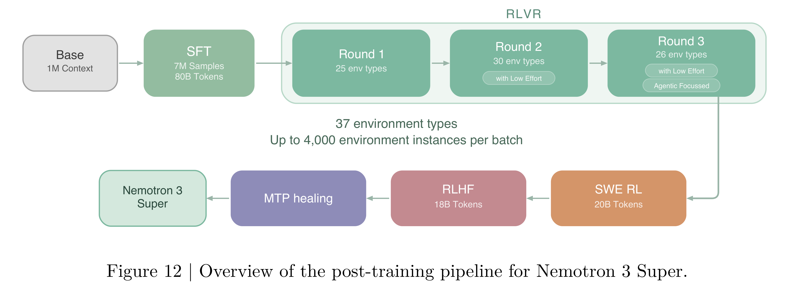

# NVIDIA Nemotron 3 Super Technical Report

[PDF](../../pdfs/nvidia/technical-reports/nvidia-nemotron-3-super-technical-report.pdf#page=1) · [Official source](https://research.nvidia.com/labs/nemotron/Nemotron-3/)

## Abstract.

We describe the pre-training, post-training, and quantization of Nemotron 3 Super, a 120 billion (active 12 billion) parameter hybrid Mamba-Attention Mixture-of-Experts model. Nemotron 3 Super is the first model in the Nemotron 3 family to 1) be pre-trained in NVFP4, 2) leverage LatentMoE, a new Mixture-of-Experts architecture that optimizes for both accuracy per FLOP and accuracy per parameter, and 3) include MTP layers for inference acceleration through native speculative decoding. We pre-trained Nemotron 3 Super on 25 trillion tokens followed by post-training using supervised fine tuning (SFT) and reinforcement learning (RL). The final model supports up to 1M context length and achieves comparable accuracy on common benchmarks, while also achieving up to 2.2× and 7.5× higher inference throughput compared to GPT-OSS-120B and Qwen3.5-122B, respectively. Nemotron 3 Super datasets, along with the base, post-trained, and quantized checkpoints, are open-sourced on HuggingFace.

Figure 1 | Accuracy and throughput comparisons of Nemotron 3 Super with GPT-OSS-120B and
Qwen3.5-122B. Nemotron 3 Super achieves comparable accuracies across popular benchmarks but
provides the highest inference throughput; on 8k input sequence lengths and 64k output sequence
lengths, Nemotron 3 Super provides up to 2.2× and 7.5× higher throughput than GPT-OSS-120B
and Qwen3.5-122B, respectively. We measured throughput on B200 GPUs with vLLM and TRT-LLM
and use the best out of the two frameworks for each model. For GPT-OSS-120B we use MXFP4
weights, MXFP8 activations, and FP8 KV-Cache; for Qwen3.5-122B we use BF16. We used the
OpenHands harness to evaluate SWE-Bench.

[p. 2](../../pdfs/nvidia/technical-reports/nvidia-nemotron-3-super-technical-report.pdf#page=2) · [PDF](../../figures/nvidia/nvidia-nemotron-3-super-technical-report/figure-01.pdf)

Figure 12 | Overview of the post-training pipeline for Nemotron 3 Super.

[p. 18](../../pdfs/nvidia/technical-reports/nvidia-nemotron-3-super-technical-report.pdf#page=18) · [PDF](../../figures/nvidia/nvidia-nemotron-3-super-technical-report/figure-02.pdf)
