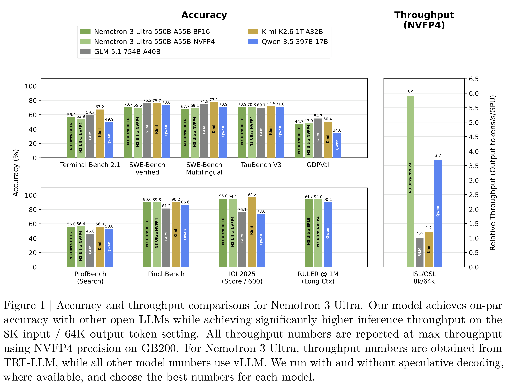
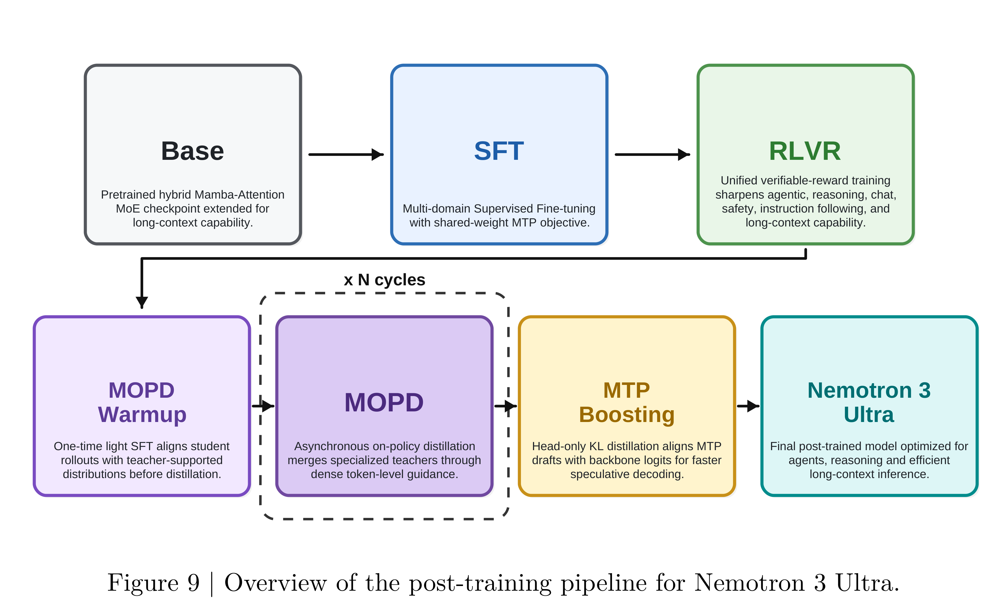

# NVIDIA Nemotron 3 Ultra Technical Report

[PDF](../../pdfs/nvidia/technical-reports/nvidia-nemotron-3-ultra-technical-report.pdf#page=1) · [Official source](https://research.nvidia.com/labs/nemotron/Nemotron-3/)

## Abstract.

We introduce Nemotron 3 Ultra, a 550 billion total and 55 billion active parameter Mixture-of-Experts Hybrid Mamba-Attention language model. We pre-trained Nemotron 3 Ultra on 20 trillion text tokens, then extended the context length to 1M tokens, and post-trained using Supervised Fine Tuning (SFT), Reinforcement Learning (RL), and Multi-teacher On-Policy Distillation (MOPD). Nemotron 3 Ultra is our most capable model yet, employing multiple key technologies - LatentMoE, Multi Token Prediction (MTP), NVFP4 pre-training, multi-environment RLVR, MOPD, and reasoning budget control. Nemotron 3 Ultra achieves up to ∼ 6× higher inference throughput as compared to state-of-the-art publicly available LLMs while attaining on-par accuracy. The state-of-the-art accuracy, high inference throughput, and 1M token context length make Nemotron 3 Ultra ideal for long-running autonomous agentic tasks. We open-source the base, post-trained, and quantized checkpoints, along with the training data and recipe on HuggingFace.

Figure 1 | Accuracy and throughput comparisons for Nemotron 3 Ultra. Our model achieves on-par
accuracy with other open LLMs while achieving significantly higher inference throughput on the
8K input / 64K output token setting. All throughput numbers are reported at max-throughput
using NVFP4 precision on GB200. For Nemotron 3 Ultra, throughput numbers are obtained from
TRT-LLM, while all other model numbers use vLLM. We run with and without speculative decoding,
where available, and choose the best numbers for each model.

[p. 2](../../pdfs/nvidia/technical-reports/nvidia-nemotron-3-ultra-technical-report.pdf#page=2) · [PDF](../../figures/nvidia/nvidia-nemotron-3-ultra-technical-report/figure-01.pdf)

Figure 9 | Overview of the post-training pipeline for Nemotron 3 Ultra.

[p. 15](../../pdfs/nvidia/technical-reports/nvidia-nemotron-3-ultra-technical-report.pdf#page=15) · [PDF](../../figures/nvidia/nvidia-nemotron-3-ultra-technical-report/figure-02.pdf)
