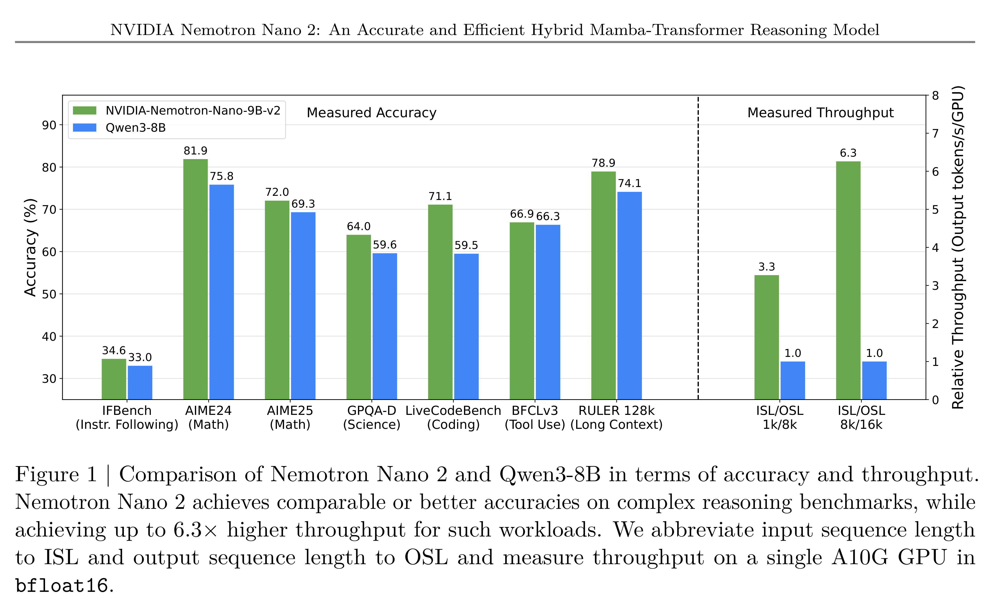

# NVIDIA Nemotron Nano 2: An Accurate and Efficient Hybrid Mamba-Transformer Reasoning Model

[Official source](https://arxiv.org/abs/2508.14444)

## Abstract.

We introduce Nemotron-Nano-9B-v2, a hybrid Mamba-Transformer language model designed to increase throughput for reasoning workloads while achieving state-of-the-art accuracy compared to similarly-sized models. Nemotron-Nano-9B-v2 builds on the Nemotron-H architecture, in which the majority of the self-attention layers in the common Transformer architecture are replaced with Mamba-2 layers, to achieve improved inference speed when generating the long thinking traces needed for reasoning. We create Nemotron-Nano-9B-v2 by first pre-training a 12-billion-parameter model (Nemotron-Nano-12B-v2-Base) on 20 trillion tokens using an FP8 training recipe. After aligning Nemotron-Nano-12B-v2-Base, we employ the Minitron strategy to compress and distill the model with the goal of enabling inference on up to 128k tokens on a single NVIDIA A10G GPU (22GiB of memory, bfloat16 precision). Compared to existing similarly-sized models (e.g., Qwen3-8B), we show that Nemotron-Nano-9B-v2 achieves on-par or better accuracy on reasoning benchmarks while achieving up to 6× higher inference throughput in reasoning settings like 8k input and 16k output tokens (Figure 1). We are releasing Nemotron-Nano-9B-v2, Nemotron-Nano- 12B-v2-Base, and Nemotron-Nano-9B-v2-Base checkpoints along with the majority of our pre- and post-training datasets on Hugging Face.

Figure 1 | Comparison of Nemotron Nano 2 and Qwen3-8B in terms of accuracy and throughput. Nemotron Nano 2 achieves comparable or better accuracies on complex reasoning benchmarks, while achieving up to 6.3× higher throughput for such workloads. We abbreviate input sequence length to ISL and output sequence length to OSL and measure throughput on a single A10G GPU in bfloat16.

p. 2
