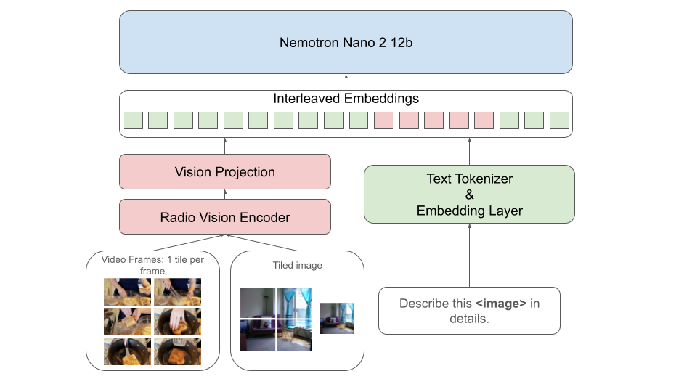

# NVIDIA Nemotron Nano V2 VL

[Official source](https://research.nvidia.com/labs/adlr/)

## Abstract.

We introduce Nemotron Nano V2 VL, the latest model of the Nemotron vision-language series designed for strong real-world document understanding, long video comprehension, and reasoning tasks. Nemotron Nano V2 VL delivers significant improvements over our previous model, Llama-3.1-Nemotron-Nano-VL-8B, across all vision and text domains through major enhancements in model architecture, datasets, and training recipes. Nemotron Nano V2 VL builds on Nemotron Nano V2, a hybrid Mamba-Transformer LLM, and innovative token reduction techniques to achieve higher inference throughput in long document and video scenarios. We are releasing model checkpoints in BF16, FP8, and FP4 formats and sharing large parts of our datasets, recipes and training code.

Figure 1 | Visualization of our VLM architecture. For images, we extract a dynamic number of tiles based on the image aspect ratio. For videos, we uniformly extract frames. Tiles and frames are resized to 512 × 512 pixels, and go through the RADIO vision encoder and an MLP connector. The image and text embeddings are interleaved, and fed to the Nemotron-Nano-12B-V2 LLM.

p. 2
