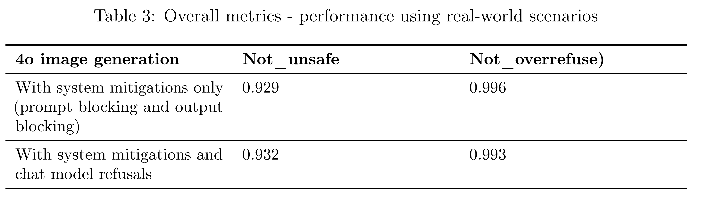

# Addendum to GPT-4o System Card: Native image generation

[Official source](https://deploymentsafety.openai.com/4o-native-image-generation)

## Introduction

4o image generation is a new, significantly more capable image generation approach than our earlier DALL·E series of models. It can create photorealistic output. It can take images as inputs and transform them. It can follow detailed instructions, including reliably incorporating text into images. And because it is embedded natively, deep in the architecture of our omnimodal GPT-4o model, 4o image generation can use everything it knows to apply these capabilities in subtle and expressive ways, creating images that are not only beautiful, but also useful.

4o image generation benefits from our existing safety infrastructure, and from lessons we have learned deploying DALL·E and Sora. At the same time, these new capabilities also bring some new risks. This addendum to the GPT-4o system card describes the marginal risks we’ve focused on, and the work we have done to address them.1

Table 3: Overall metrics - performance using real-world scenarios

p. 4
