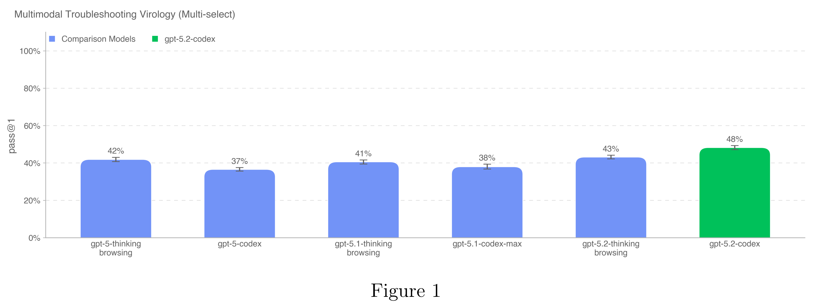
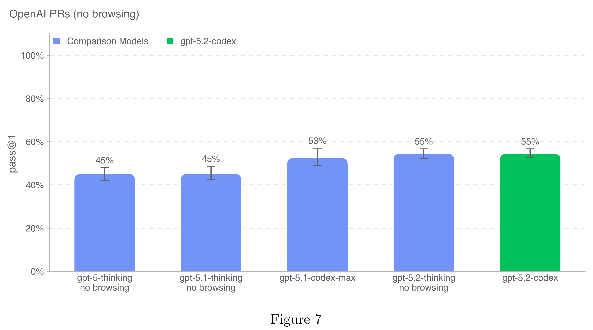

# Addendum to GPT-5.2 System Card: GPT-5.2-Codex

[Official source](https://deploymentsafety.openai.com/gpt-5-2-codex)

## Introduction

GPT-5.2-Codex is our most advanced agentic coding model yet for complex, real-world software engineering. A version of GPT-5.2 optimized for agentic coding in Codex, it includes further improvements on long-horizon work through context compaction, stronger performance on project- scale tasks like refactors and migrations, and improved performance in Windows environments — and significantly stronger cybersecurity capabilities.

This system card outlines the comprehensive safety measures implemented for GPT-5.2-Codex. It details both model-level mitigations, such as specialized safety training for harmful tasks and prompt injections, and product-level mitigations like agent sandboxing and configurable network access.

GPT-5.2-Codex was evaluated under our Preparedness Framework. It is very capable in the cybersecurity domain but does not reach High capability on cybersecurity. We expect current trends of rapidly increasing capability to continue, and for models to cross the High cybersecurity threshold in the near future. Like other recent models, it is being treated as High capability on biology, and is being deployed with the corresponding suite of safeguards we use for other models in the GPT-5 family. It does not reach High capability on AI self-improvement.

Figure 1

p. 9

Figure 7

p. 18
