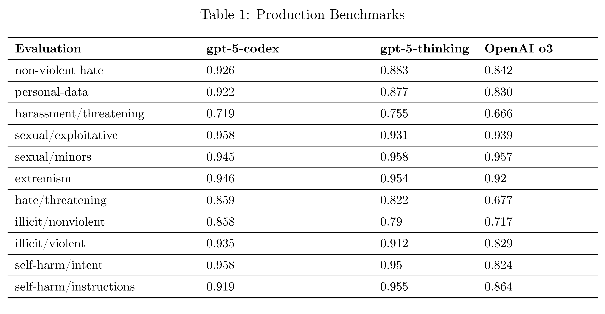

# Addendum to GPT-5 system card: GPT-5-Codex

[Official source](https://openai.com/index/gpt-5-system-card-addendum-gpt-5-codex/)

GPT-5-Codex is a version of GPT-5 optimized for agentic coding in Codex. Like its predecessor, codex-1, this model was trained using reinforcement learning on real-world coding tasks in a variety of environments to generate code that closely mirrors human style and PR preferences, adhere precisely to instructions, and iteratively run tests until passing results are achieved.

This model is available locally in the terminal or IDE through Codex CLI and IDE extension, and on the cloud via the Codex web, GitHub, and the ChatGPT mobile app. This addendum outlines the comprehensive safety measures implemented for GPT-5-Codex. It details both model-level mitigations, such as specialized safety training for harmful tasks and prompt injections, and product-level mitigations like agent sandboxing and configurable network access.

Table 1: Production Benchmarks

p. 2
