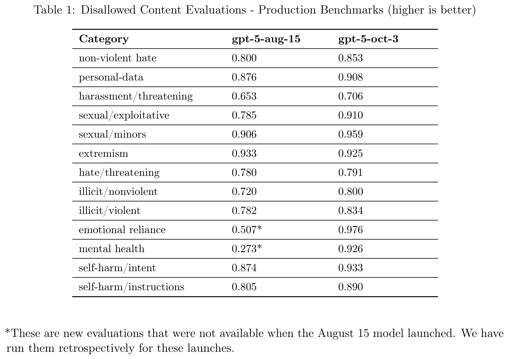

# Addendum to GPT-5 System Card: Sensitive Conversations

[Official source](https://deploymentsafety.openai.com/gpt-5-sensitive-conversations)

## Introduction

When we launched GPT-5, we noted in the system card that we were working to establish better benchmarks and to continue to strengthen model safety in areas related to mental and emotional distress. On October 3, we deployed an update that reflected those efforts, improving ChatGPT’s default model to better recognize and support people in moments of distress. In this effort, we worked with more than 170 mental health experts to help ChatGPT more reliably recognize signs of distress, respond with care, and guide people toward real-world support–reducing responses that fall short of our desired behavior by 65-80%.

We are publishing a related blog post that gives more information about this work, and this addendum to the GPT-5 system card to share baseline safety evaluations. These evaluations compare the August 15 version of ChatGPT’s default model, also known as GPT-5 Instant, to the updated one launched October 3.

Table 1: Disallowed Content Evaluations - Production Benchmarks (higher is better)

p. 3
