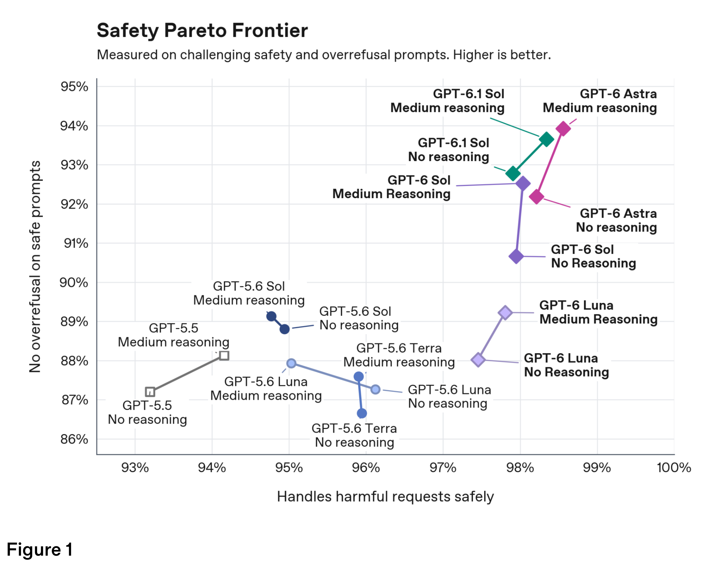
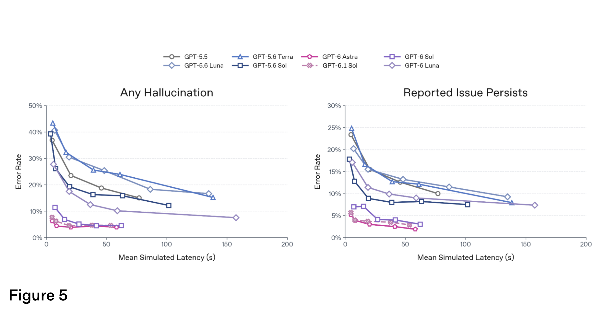

# Addendum to GPT-6 Astra System Card: GPT-6.1 Sol

[Official source](https://deploymentsafety.openai.com/gpt-6-1-sol)

## Introduction

Today, we’re introducing GPT-6.1 Sol. GPT-6.1 is the latest model family in the GPT-6 series.

GPT-6.1 Sol delivers capabilities comparable to those of our most powerful model, GPT-6 Astra, with an unmatched combination of speed and afford- ability. This system card addendum provides updates on the baseline safety metrics and evaluation results for GPT-6.1 Sol.1

Under our Preparedness Framework, we are treating GPT-6.1 Sol as Critical in cybersecurity and High for Biological and Chemical capability. Based on that assessment, GPT-6.1 Sol uses the same safeguards stack as GPT-6 Astra, described in detail in the GPT-6 Astra system card.

Figure 1

p. 6

Figure 5

p. 14
