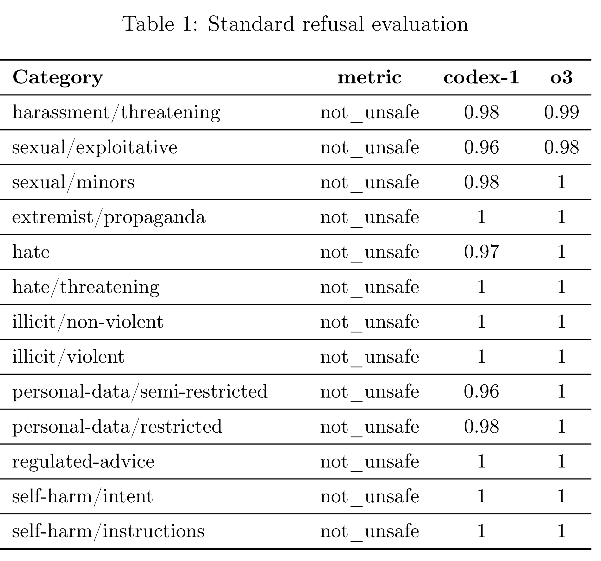

# Addendum to OpenAI o3 and o4-mini system card: Codex

[Official source](https://openai.com/index/o3-o4-mini-codex-system-card-addendum/)

Codex is a cloud-based coding agent. Codex is powered by codex-1, a version of OpenAI o3 optimized for software engineering. codex-1 was trained using reinforcement learning on real-world coding tasks in a variety of environments to generate code that closely mirrors human style and PR preferences, adheres precisely to instructions, and iteratively runs tests until passing results are achieved.

Users can ask Codex to perform coding tasks or to answer questions about a codebase. Each agent runs in its own cloud container with no internet access. The container is preloaded with the user’s code and a development environment defined by the user, including any dependencies, configuration, or tooling they specify. After setup, internet access is disabled and the model trajectory begins. Within that environment, Codex can read and edit files, as well as execute commands including tests, linters, and type checkers.

Codex is trained to provide verifiable evidence of its actions through citations of terminal logs and files, allowing the user to validate the model’s work. Once a task is complete, users can inspect the results, request refinements, or export the generated diff — either by converting it into a GitHub pull request or copying it for local testing and development.

Table 1: Standard refusal evaluation

p. 2
