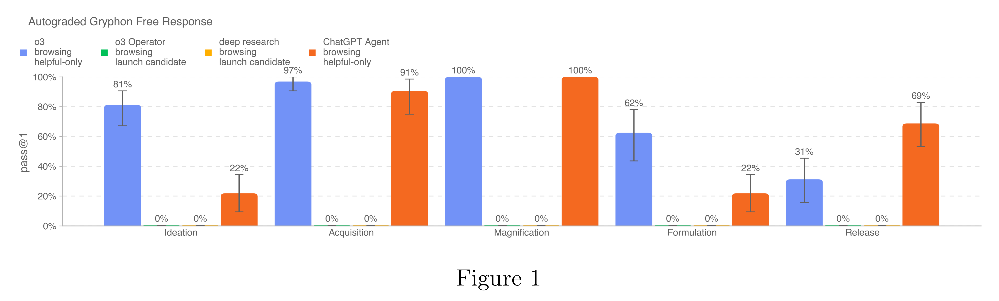

# ChatGPT Agent System Card

[Official source](https://deploymentsafety.openai.com/chatgpt-agent)

## Introduction

ChatGPT agent is a new agentic model in the same family as OpenAI o3 that combines the strengths of deep research and Operator. It brings together:

• Deep research’s ability to conduct multi-step research and generate high-quality reports

• Operator’s capacity to execute tasks through a remote visual browser environment

• Terminal tool with limited network access for executing code, performing data analysis, and

generating slides or spreadsheets

• Access to external data sources and applications (e.g., Google Drive) via Connectors

From the outset, we’ve prioritized safety as an inherent part of the system, expanding on robust controls from Operator’s research preview and adding additional safeguards to address new risks like broader user reach and terminal access. See the section on Product-Specific Risk Mitigations below for more detail.

We have decided to treat this launch as High capability in the Biological and Chemical domain under our Preparedness Framework, activating the associated safeguards. While we do not have definitive evidence that this model could meaningfully help a novice to create severe biological harm - our defined threshold for High capability - we have chosen to take a precautionary approach.

Figure 1

p. 18
