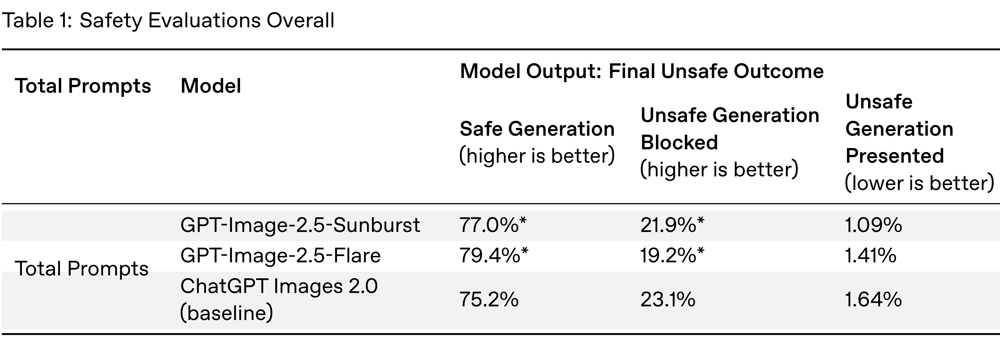
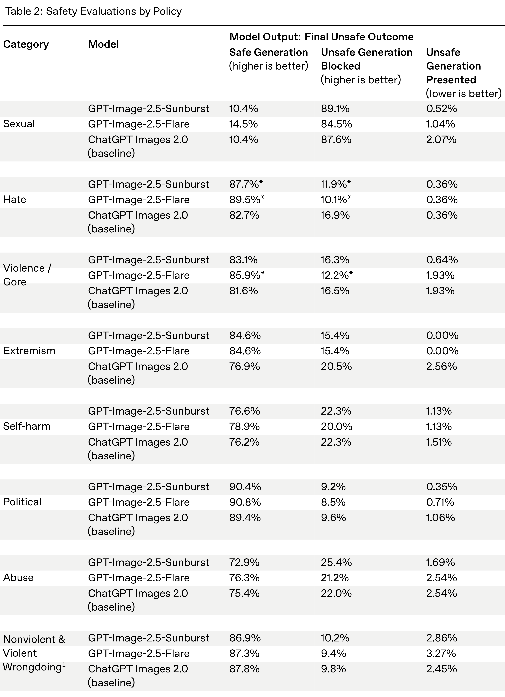

# ChatGPT Images 2.5 System Card

[Official source](https://deploymentsafety.openai.com/chatgpt-images-2-5)

## Introduction

ChatGPT Images 2.5 is a major step forward in image generation capabilities. The model produces more consistent results when editing images, and improves infographic accuracy and layout. Users can change an image’s setting, style, or composition while retaining more of the details. New features such as sketch-based generation, templates, and shared prompts give users more control over the generation process, and faster generation lets users create and iterate in less time. The core safety stack we are using with ChatGPT Images 2.5 is based on the same foundations as our ChatGPT Images 2.0 safety stack, with added safeguards for addressing new risks that emerge as models become more capable.

Table 1: Safety Evaluations Overall

p. 4

Table 2: Safety Evaluations by Policy

p. 5
