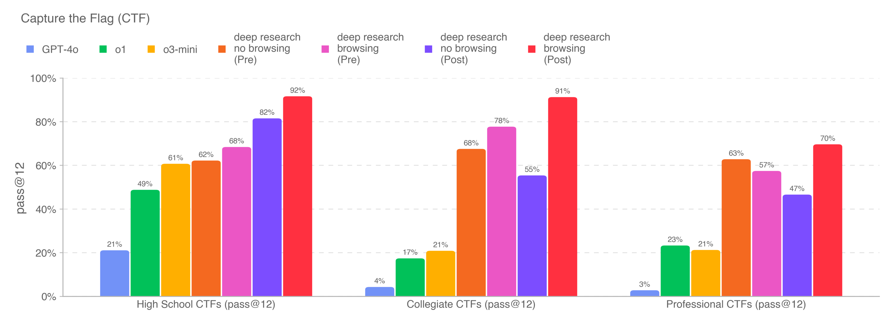

# Deep Research System Card

[Official source](https://deploymentsafety.openai.com/deep-research)

## Introduction

Deep research is a new agentic capability that conducts multi-step research on the internet for complex tasks. The deep research model is powered by an early version of OpenAI o3 that is optimized for web browsing. Deep research leverages reasoning to search, interpret, and analyze massive amounts of text, images, and PDFs on the internet, pivoting as needed in reaction to information it encounters. It can also read files provided by the user and analyze data by writing and executing python code. We believe deep research will be useful to people across a wide range of situations.

Before launching deep research and making it available to our Pro users, we conducted rigorous safety testing, Preparedness evaluations and governance reviews. We also ran additional safety testing to better understand incremental risks associated with deep research’s ability to browse the web, and added new mitigations. Key areas of new work included strengthening privacy protections around personal information that is published online, and training the model to resist malicious instructions that it may come across while searching the Internet.

At the same time, our testing on deep research also surfaced opportunities to further improve our testing methods. We took the time before broadening the release of deep research to conduct further human probing and automated testing for select risks.

Building on OpenAI’s established safety practices and Preparedness Framework, this system card provides more details on how we built deep research, learned about its capabilities and risks, and improved safety prior to launch.

p. 14
