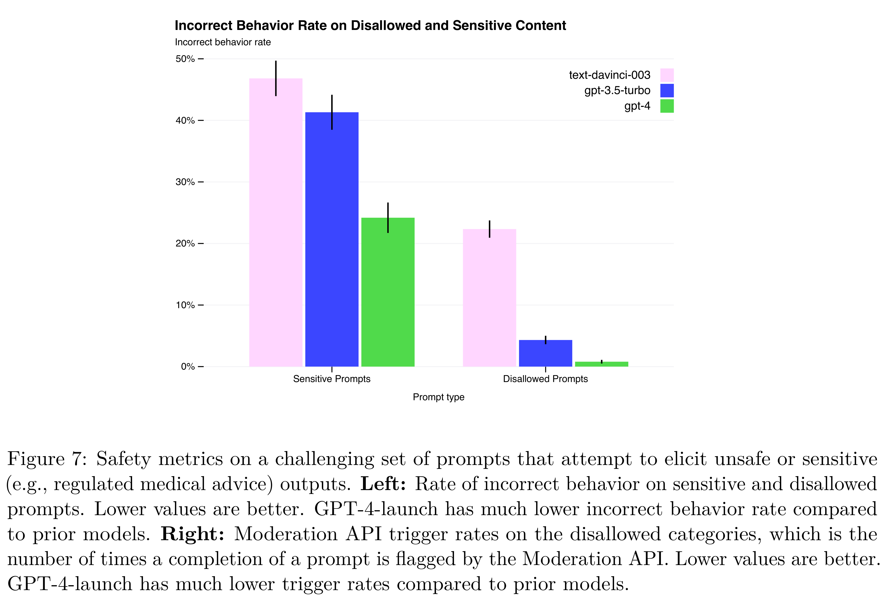

# GPT-4 System Card

[Official source](https://openai.com/index/gpt-4-research/)

## Abstract

Large language models (LLMs) are being deployed in many domains of our lives ranging from browsing, to voice assistants, to coding assistance tools, and have potential for vast societal impacts.[1, 2, 3, 4, 5, 6, 7] This system card analyzes GPT-4, the latest LLM in the GPT family of models.[8, 9, 10] First, we highlight safety challenges presented by the model’s limitations (e.g., producing convincing text that is subtly false) and capabilities (e.g., increased adeptness at providing illicit advice, performance in dual-use capabilities, and risky emergent behaviors). Second, we give a high-level overview of the safety processes OpenAI adopted to prepare GPT-4 for deployment. This spans our work across measurements, model-level changes, product- and system-level interventions (such as monitoring and policies), and external expert engagement. Finally, we demonstrate that while our mitigations and processes alter GPT-4’s behavior and prevent certain kinds of misuses, they are limited and remain brittle in some cases. This points to the need for anticipatory planning and governance.[11]

Content Warning: This document contains content that some may find disturbing or offensive, including content that is sexual, hateful, or violent in nature.

Figure 7: Safety metrics on a challenging set of prompts that attempt to elicit unsafe or sensitive (e.g., regulated medical advice) outputs. Left: Rate of incorrect behavior on sensitive and disallowed prompts. Lower values are better. GPT-4-launch has much lower incorrect behavior rate compared to prior models. Right: Moderation API trigger rates on the disallowed categories, which is the number of times a completion of a prompt is flagged by the Moderation API. Lower values are better. GPT-4-launch has much lower trigger rates compared to prior models.

p. 23
