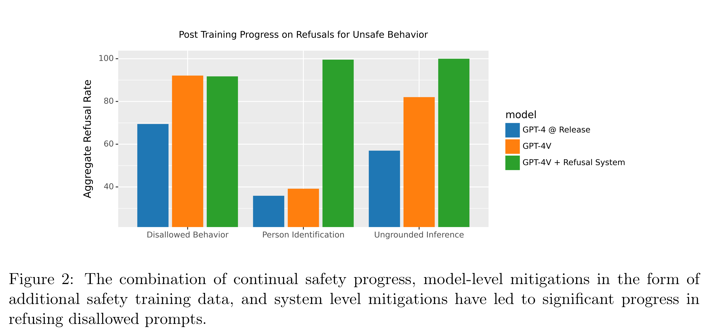

# GPT-4V(ision) System Card

[Official source](https://openai.com/index/gpt-4v-system-card/)

## Introduction

GPT-4 with vision (GPT-4V) enables users to instruct GPT-4 to analyze image inputs provided by the user, and is the latest capability we are making broadly available. Incorporating additional modalities (such as image inputs) into large language models (LLMs) is viewed by some as a key frontier in artificial intelligence research and development [1, 2, 3]. Multimodal LLMs offer the possibility of expanding the impact of language-only systems with novel interfaces and capabilities, enabling them to solve new tasks and provide novel experiences for their users.

In this system card, [4, 5] 1 we analyze the safety properties of GPT-4V. Our work on safety for GPT-4V builds on the work done for GPT-4 [7] and here we dive deeper into the evaluations, preparation, and mitigation work done specifically for image inputs.

Similar to GPT-4, training of GPT-4V was completed in 2022 and we began providing early access to the system in March 2023. As GPT-4 is the technology behind the visual capabilities of GPT-4V, its training process was the same. The pre-trained model was first trained to predict the next word in a document, using a large dataset of text and image data from the Internet as well as licensed sources of data. It was then fine-tuned with additional data, using an algorithm called reinforcement learning from human feedback (RLHF),[8, 9] to produce outputs that are preferred by human trainers.

Large multimodal models introduce different limitations and expand the risk surface compared to text-based language models. GPT-4V possesses the limitations and capabilities of each modality (text and vision), while at the same time presenting novel capabilities emerging from the intersection of said modalities and from the intelligence and reasoning afforded by large scale models.

This system card outlines how OpenAI prepared the vision capabilities of GPT-4 for deployment. It describes the early access period of the model for small scale users and safety learnings OpenAI gained from this period, multimodal evaluations built to study the model’s fitness for deployment, key findings of expert red teamers, and the mitigations OpenAI implemented prior to broad release.

Figure 2: The combination of continual safety progress, model-level mitigations in the form of additional safety training data, and system level mitigations have led to significant progress in refusing disallowed prompts.

p. 5
