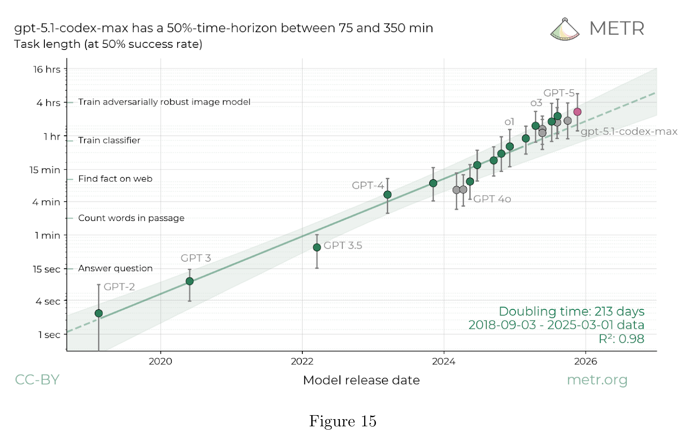
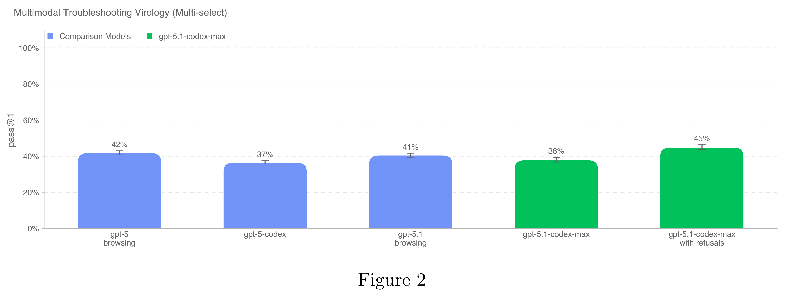

# GPT-5.1-Codex-Max System Card

[Official source](https://deploymentsafety.openai.com/gpt-5-1-codex-max)

## Introduction

GPT-5.1-Codex-Max is our new frontier agentic coding model. It is built on an update to our foundational reasoning model trained on agentic tasks across software engineering, math, research, medicine, computer use and more. It is our first model natively trained to operate across multiple context windows through a process called compaction, coherently working over millions of tokens in a single task. Like its predecessors, GPT-5.1-Codex-Max was trained on real-world software engineering tasks like PR creation, code review, frontend coding and Q&A.

This system card outlines the comprehensive safety measures implemented for GPT-5.1-Codex- Max. It details both model-level mitigations, such as specialized safety training for harmful tasks and prompt injections, and product-level mitigations like agent sandboxing and configurable network access.

GPT-5.1-Codex-Max was evaluated under our Preparedness Framework. It is very capable in the cybersecurity domain but does not reach High capability on cybersecurity. We expect current trends of rapidly increasing capability to continue, and for models to cross the High cybersecurity threshold in the near future. Like other recent models, it is being treated as High capability on biology, and is being deployed with the corresponding suite of safeguards we use for GPT-5. It does not reach High capability on AI self-improvement.

Figure 15

p. 26

Figure 2

p. 11
