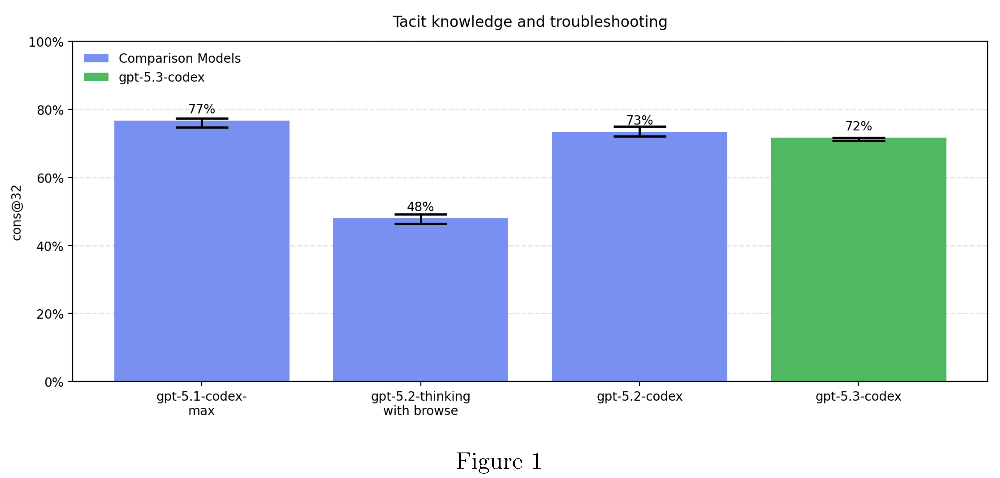
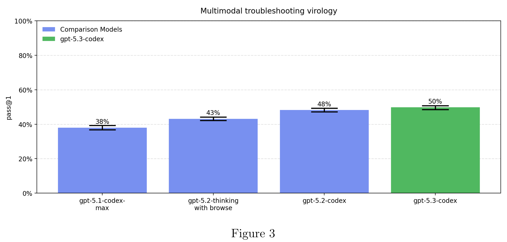

# GPT-5.3-Codex System Card

[Official source](https://deploymentsafety.openai.com/gpt-5-3-codex)

## Introduction

GPT-5.3-Codex is the most capable agentic coding model to date, combining the frontier coding performance of GPT-5.2-Codex with the reasoning and professional knowledge capabilities of GPT-5.2. This enables it to take on long-running tasks that involve research, tool use, and complex execution. Much like a colleague, you can steer and interact with GPT-5.3-Codex while it’s working, without losing context.

Like other recent models, it is being treated as High capability on biology, and is being deployed with the corresponding suite of safeguards we use for other models in the GPT-5 family. It does not reach High capability on AI self-improvement.

This is the first launch we are treating as High capability in the Cybersecurity domain under our Preparedness Framework, activating the associated safeguards. We do not have definitive evidence that this model reaches our High threshold, but are taking a precautionary approach because we cannot rule out the possibility that it may be capable enough to reach the threshold. Our safeguards for high capability in cybersecurity rely on a layered safety stack designed to impede and disrupt threat actors, while we work to make these same capabilities as easily available as possible for cyber defenders.

Figure 1

p. 8

Figure 3

p. 10
