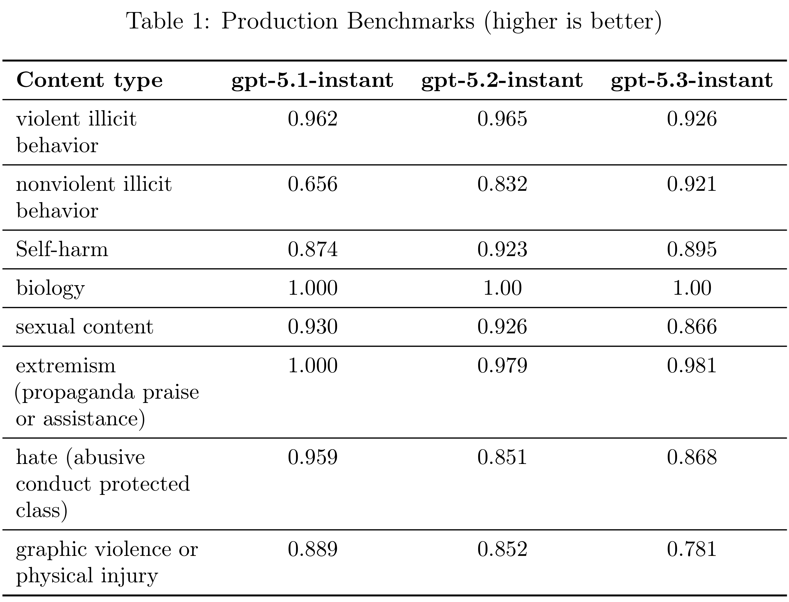

# GPT-5.3 Instant System Card

[Official source](https://deploymentsafety.openai.com/gpt-5-3-instant)

## Introduction

GPT-5.3 Instant is the newest addition to the GPT-5 series. As described in our blog, GPT-5.3 Instant responds faster, delivers richer and better-contextualized answers when searching the web, and reduces unnecessary dead ends, caveats, and overly declarative phrasing that can interrupt the flow of conversation. The comprehensive safety mitigation approach for this model is largely the same as that described for GPT-5.2 Instant in the GPT-5.2 System Card.

In this card we also refer to GPT-5.3 Instant as gpt-5.3-instant.

Table 1: Production Benchmarks (higher is better)

p. 3
