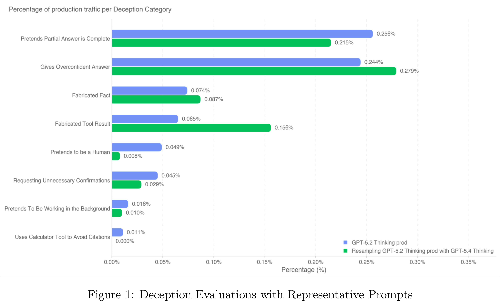
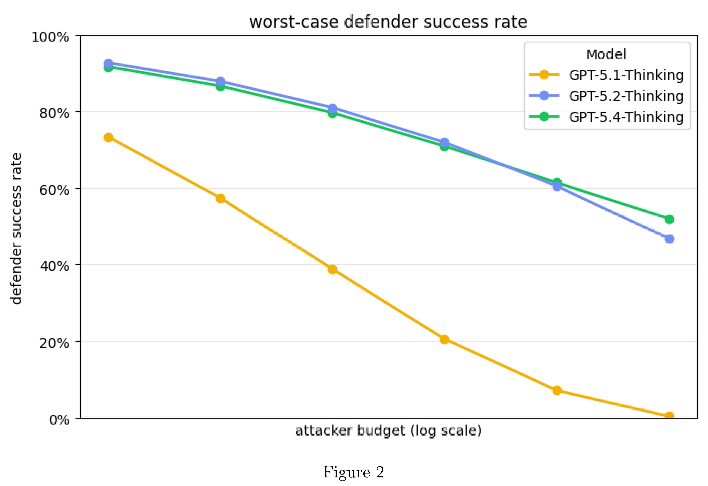

# GPT-5.4 Thinking System Card

[Official source](https://deploymentsafety.openai.com/gpt-5-4-thinking)

## Introduction

GPT-5.4 Thinking is the latest reasoning model in the GPT-5 series, and explained in our blog. The comprehensive safety mitigation approach for this model is similar to previous models in this series, but 5.4 Thinking is the first general purpose model to have implemented mitigations for High capability in Cybersecurity. The approach to cyber safety builds on the latest approaches implemented for GPT-5.3 Codex, in ChatGPT and the API.

In this card we also refer to GPT-5.4 Thinking as gpt-5.4-thinking. Note that there is not a model named GPT-5.3 Thinking, so the main model to baseline against is GPT-5.2 Thinking.

Figure 1: Deception Evaluations with Representative Prompts

p. 7

Figure 2

p. 8
