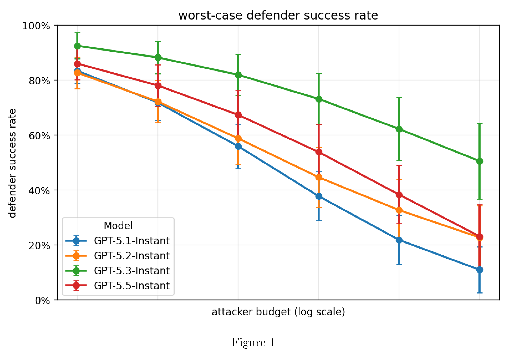
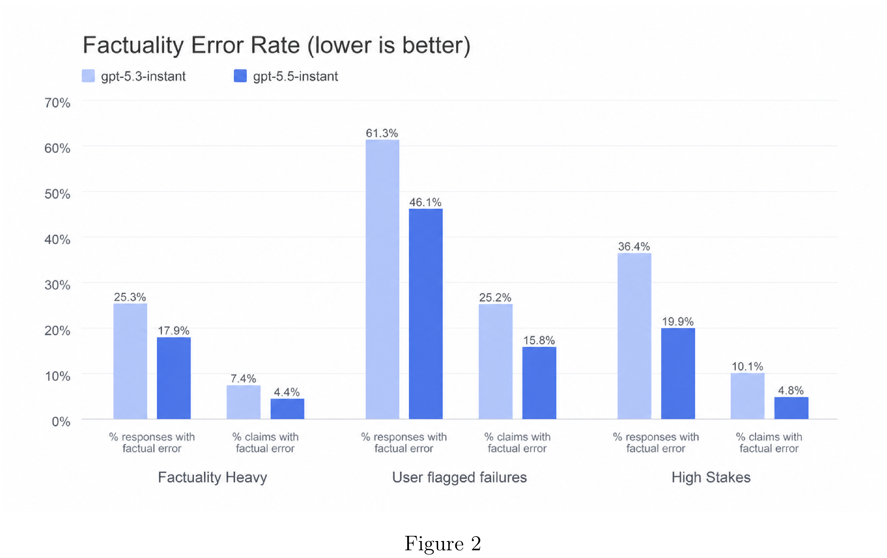

# GPT-5.5 Instant System Card

[Official source](https://deploymentsafety.openai.com/gpt-5-5-instant)

## Introduction

GPT-5.5 Instant is our latest Instant model, and explained in our blog. The comprehensive safety mitigation approach for this model is similar to previous models in this series, but this is the first Instant model that we are treating as High capability in our Cybersecurity and Biological & Chemical Preparedness categories, and implementing appropriate safeguards.

In this card we also refer to GPT-5.5 Instant as gpt-5.5-instant. Note that there is not a model named GPT-5.4 Instant, and the main model to baseline against is GPT-5.3 Instant. Additionally, we refer to GPT-5.5 as GPT-5.5 Thinking to avoid confusion with the instant model.

Figure 1

p. 7

Figure 2

p. 10
