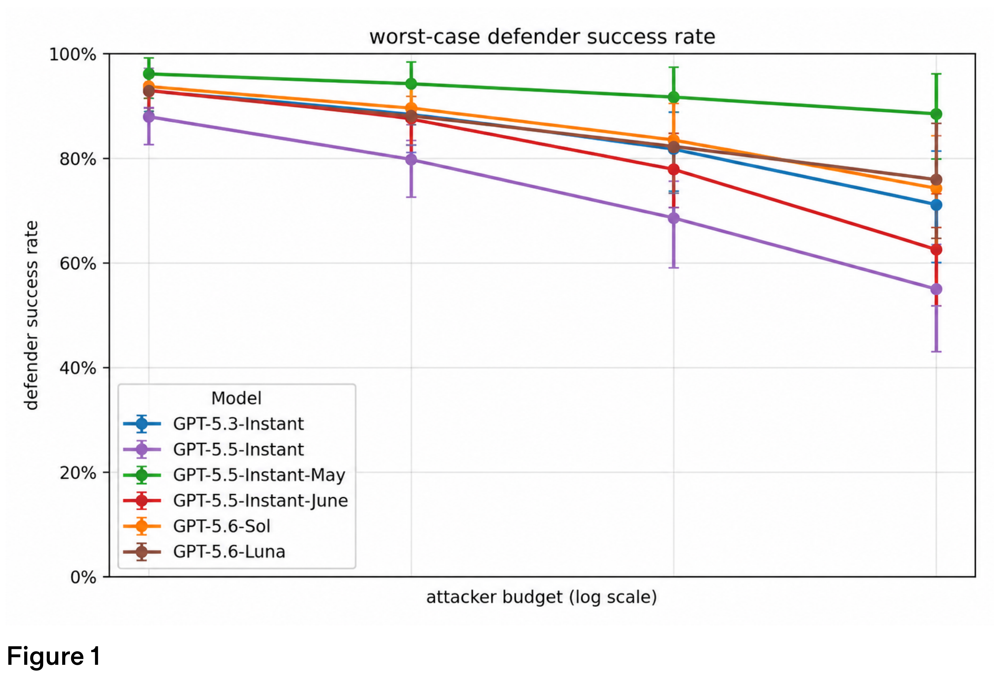
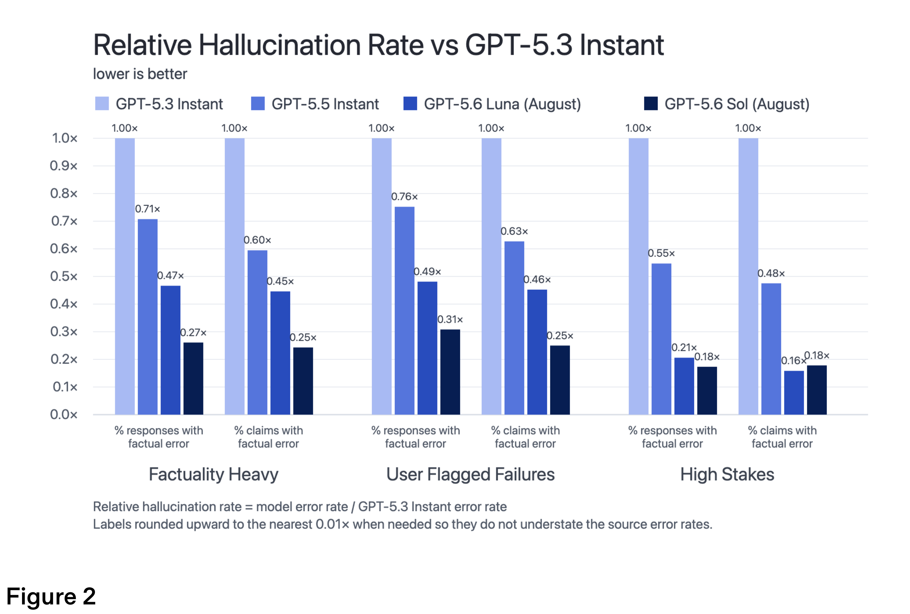

# GPT-5.6 — August Updates

[Official source](https://deploymentsafety.openai.com/gpt-5-6-august-update)

## Introduction

Starting today, we’re updating ChatGPT with a more capable model and expanding access for everyone. Free and Go users will get a new default model for everyday chats. Plus and Pro users will get an updated GPT-5.6 Sol with a slider that lets them choose how much effort ChatGPT uses for a response. These models will replace GPT-5.5 Instant. Users accessing GPT-5.6 Sol and GPT-5.6 Luna in Codex, and via ChatGPT Work, are still using previously released versions of GPT-5.6 Sol and GPT-5.6 Luna. In this system card, we distinguish these models by their month of release: August for the versions released today, and July for the versions that remain in use in Codex and Work. See our blog for details.

Under our Preparedness Framework, we are treating this August release of GPT-5.6 Sol and GPT-5.6 Luna as High capability in both Cybersecurity and Biological and Chemical domains. Neither one reaches our High threshold in AI Self-Improvement. Based on that assessment, we’ve implemented the same set of safeguards that are detailed in the GPT-5.6 System Card.

For all safety evaluations, such as disallowed content and mental health, we measure performance of our models at their lowest reasoning deployment settings, like in instant, in order to capture performance for the vast majority of usage. For capabilities assessments, we evaluate the models at their maximum reasoning effort to get an upper bound of capabilities.

With this launch, we’re also sharing more about our ongoing work to help make ChatGPT safer for teens. For the first time, we are including dedicated U18 evaluations designed to measure model behavior against teen-specific safety standards.

Figure 1

p. 10

Figure 2

p. 13
