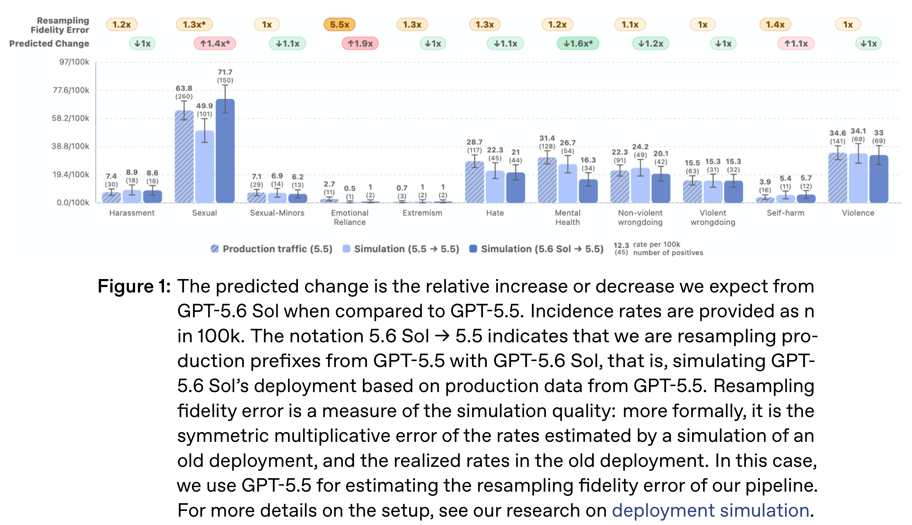
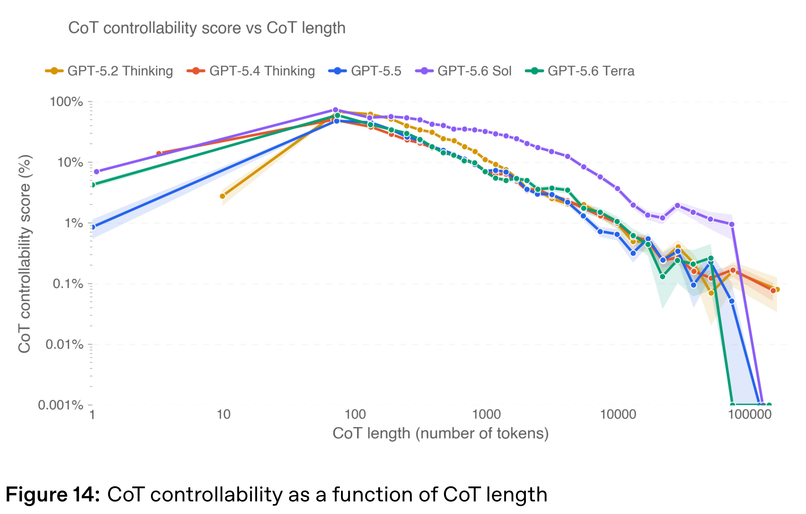

# GPT-5.6 System Card

[Official source](https://deploymentsafety.openai.com/gpt-5-6)

## Introduction

GPT-5.6 is a new family of three models: Sol, our new flagship model; Terra, a capable lower-cost option; and Luna, our fastest and most cost-efficient model. The safeguards we have built for this launch—our most robust yet— are built to deliver these models safely and at scale, around the world.

Under our Preparedness Framework, we are treating Sol, Terra and Luna as High capability in both Cybersecurity and Biological and Chemical risk. None of them reach our High threshold in AI Self-Improvement. We have implemented a tailored set of safeguards, adapted to each model’s capability profile, to sufficiently minimize the associated risks.

This system card is a detailed report of the work we did to understand and mitigate GPT-5.6’s safety risks before deployment. The six most important things to know are that:

Figure 1: The predicted change is the relative increase or decrease we expect from

p. 9

Figure 14: CoT controllability as a function of CoT length

p. 29
